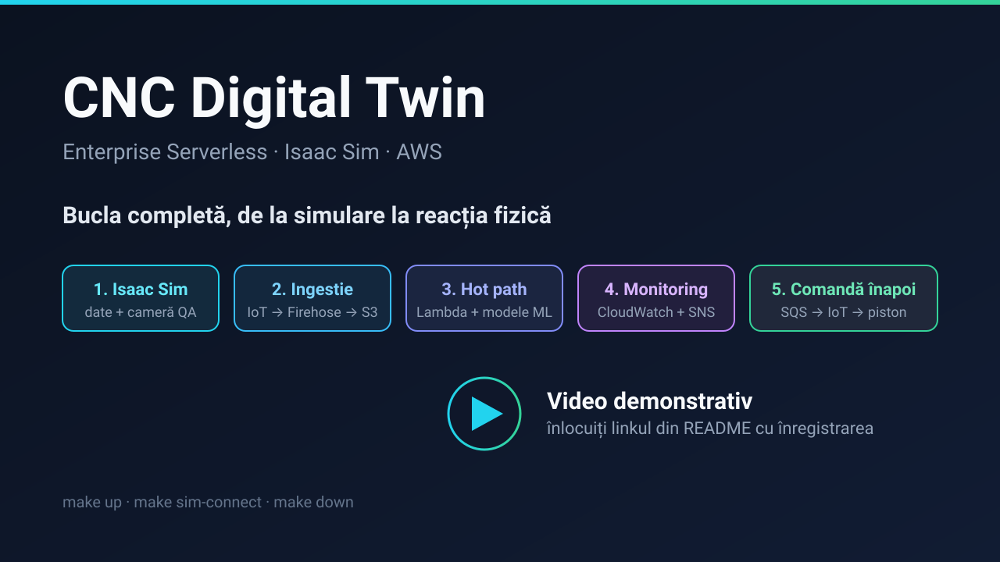
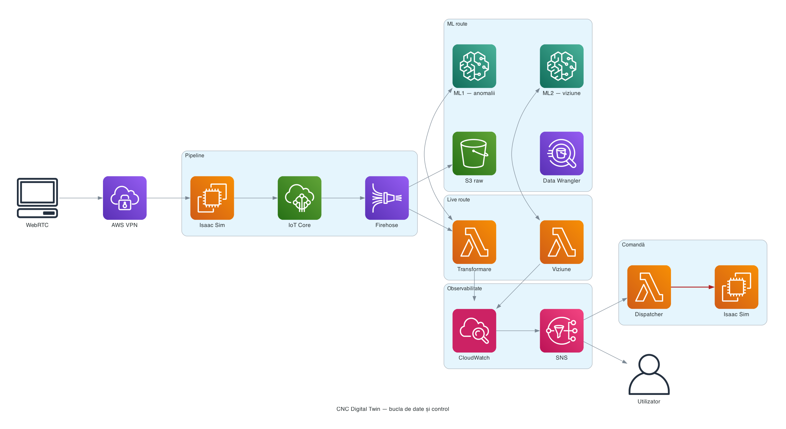

# CNC Digital Twin — Enterprise Serverless

<!-- Video demonstrativ: înlocuiți linkul de mai jos. Detalii în docs/assets/README.md -->
[](https://REPLACE-CU-LINK-VIDEO)

**Video demonstrativ:** înlocuiți `https://REPLACE-CU-LINK-VIDEO` cu înregistrarea buclei
complete. Miniatura și instrucțiunile: [`docs/assets/README.md`](docs/assets/README.md).

Geamăn digital industrial pentru o celulă de prelucrare CNC și inspecție de calitate:
simularea fizică rulează în NVIDIA Isaac Sim, telemetria și cadrele de inspecție ajung în AWS,
două modele ML analizează fluxul, CloudWatch supraveghează totul, iar verdictul se întoarce
ca acțiune fizică în simulare. Toată infrastructura este definită în Terraform, iar ciclul
complet de la zero la demonstrație și înapoi se face cu `make up` și `make down`.

Sistemul demonstrează o buclă închisă:

1. **Simulare** — celula CNC rulează în Isaac Sim și publică telemetrie plus cadre de inspecție.
2. **Ingestie** — MQTT cu mTLS intră în IoT Core, apoi în Firehose și în data lake-ul S3.
3. **Hot path** — Lambda calculează caracteristici pe micro-lot și cheamă modelele SageMaker.
4. **Monitorizare și notificări** — CloudWatch agregă metrice și alarme, SNS trimite e-mailuri.
5. **Comandă înapoi** — verdictul de calitate și comenzile operatorului ajung la Isaac Sim.

## Arhitectura



Diagramele sunt generate din cod (`docs/diagrams/architecture.py`, cu `make diagrams`):
[bucla de date și control](docs/diagrams/architecture-loop.png) și
[platforma](docs/diagrams/architecture-platform.png).

```text
  1. SIMULARE      Isaac Sim pe EC2 GPU efemer ── WebRTC ──▶ browser
                   extensia cncdt.cnc_cell: UI, degradare, senzori, cameră QA
        │  MQTT (mTLS): telemetrie + cadre QA
        ▼
  2. INGESTIE      AWS IoT Core ──▶ Amazon Data Firehose (micro-lot 60 s)
                   ──▶ S3 Data Lake (Parquet partiționat, KMS, lifecycle)
        │  transformare Lambda pe fiecare micro-lot
        ▼
  3. HOT PATH      Lambda feature-engineering ──▶ endpoint ML1 (anomalii)
                   Lambda qa-vision (eveniment S3) ──▶ endpoint ML2 (viziune)
        │  metrice + verdict
        ▼
  4. MONITORIZARE  CloudWatch: metrice, alarme, alarmă compusă, dashboard
  5. NOTIFICĂRI    SNS ──▶ e-mail (abonamente alarm_email_endpoints)
        │  verdict REJECT / comandă operator
        ▼
  6. COMANDĂ       SQS ──▶ control-dispatcher ──▶ topic IoT ──▶ Isaac Sim (piston)

  OFFLINE (construcția modelelor):
  SageMaker Studio + Data Wrangler ──▶ antrenare ──▶ model.tar.gz în S3
                                    ──▶ endpoint-urile ML1 / ML2 din hot path
```

### Etapele și unde trăiesc în infrastructură

| Etapă | Ce face | Resurse Terraform | Comandă |
| --- | --- | --- | --- |
| 0. Acces | Rol de operator asumat din identitatea de admin; resursele apar în CloudTrail ca sesiuni ale rolului | `stacks/access` | `make access-up` |
| 1. Simulare | Instanță GPU efemeră (spot), streaming WebRTC, extensia de celulă, volum EBS persistent pentru stare | `stacks/sim`, `stacks/sim-data`, modulul `sim-instance` | `make sim-up` |
| 2. Ingestie | IoT Core, regulă de topic, Firehose, data lake S3, Glue ca registru | `modules/iot-ingestion`, `modules/platform-storage` | `make platform-up` |
| 3. Construcția modelelor | Studio, Data Wrangler, antrenare, endpoint-uri | `modules/sagemaker-studio`, `modules/sagemaker-endpoint`, `ml/` | `make platform-up` |
| 4. Hot path | Feature engineering, inferență QA, dispecer de comenzi | `lambdas/`, `modules/lambda-function`, SQS | `make platform-up` |
| 5. Monitorizare | Metrice, alarme, alarmă compusă, dashboard, buget de cost | `modules/observability`, `modules/budget` | `make platform-up` |
| 6. Notificări | Subiect SNS cu abonamente de e-mail, alerte de buget | `modules/observability` (`alarm_email_endpoints`), `modules/budget` | `make platform-up` |
| 7. Comandă înapoi | Topicuri IoT de control și chaos, coadă de comenzi | `modules/iot-ingestion`, `control-dispatcher` | `make platform-up` |
| 8. Igienă și cost | Buget lunar, backup zilnic al EFS-ului Studio, audit de resurse rămase | `modules/budget`, `modules/backup`, `scripts/audit.sh` | `make audit` |

Detalii: [`docs/01-architecture.md`](docs/01-architecture.md).

## Pornire și ștergere completă

O singură dată per cont se creează rolul de operator. După aceea, toate resursele sunt lansate
de sesiunea acelui rol, iar în CloudTrail apar ca acțiuni ale rolului, nu ale persoanei.

```bash
cp .env.example .env         # completați AWS_REGION, PROJECT_NAME
aws login --region eu-central-1   # sau un profil cu cheie de acces
make access-up               # o singură dată: creează rolul, cu identitatea de admin
```

În fiecare sesiune de lucru, credențialele de rol se exportă în shell, iar Terraform le
folosește din mediu:

```bash
eval "$(./scripts/assume-operator.sh)"
aws sts get-caller-identity  # arn:aws:sts::<cont>:assumed-role/cncdt-dev-operator/...
```

Detalii, MFA, durata sesiunii și revocare: [`ops/runbooks/access.md`](ops/runbooks/access.md).

Apoi două comenzi acoperă tot. Prima creează platforma serverless, apoi instanța GPU cu Isaac
Sim și afișează datele de conectare.

```bash
make sim-init             # preflight o singură dată: unelte, credențiale, cheie SSH

make up                   # TOT: platforma serverless + Isaac Sim
make sim-connect          # tunel + link către clientul WebRTC
make down                 # ȘTERGE TOT: Isaac Sim, apoi platforma (cere confirmare)
make down YES=1           # ștergere fără întrebări (demo, mediu efemer)
```

`make up` include instanța GPU, care costă ~1 USD/oră. Dacă lucrați doar la pipeline,
folosiți `make platform-up`; iar `make sim-stop` oprește costul de GPU păstrând discul.

Bucket-ul de state Terraform nu se șterge la `make down`: ține de stack-ul `bootstrap` și
supraviețuiește intenționat, ca platforma să poată fi recreată imediat.

Înainte de ștergere, `make audit` spune ce va rămâne în cont. EFS-ul de home al Studio este
păstrat de domeniu la ștergere, iar planul de backup din `modules/backup` îl salvează zilnic.

```bash
make audit                # derivă Terraform, resurse rămase, cost curent
```

Detalii și pași de curățare: [`ops/runbooks/audit.md`](ops/runbooks/audit.md).

## Comenzi pe etapă

### Isaac Sim (instanța GPU)

| Comandă | Efect |
| --- | --- |
| `make sim-up` | Lansează instanța GPU și Isaac Sim. Afișează IP-ul public, porturile, URL-ul clientului și comenzile SSH/SSM. |
| `make sim-stop` | Oprește serverul. Discul rămâne, facturarea de GPU se oprește. |
| `make sim-down` | Șterge instanța de simulare: disc rădăcină, security group, Elastic IP, cheie SSH. Volumul de date persistent rămâne și se reatașează la următorul `sim-up`. |
| `make sim-data` | Starea volumului de date persistent: ID, zonă, dimensiune, snapshot-uri, cost lunar. |
| `make sim-data-down` | ȘTERGE volumul de date (face întâi un snapshot). Cere volumul detașat, deci întâi `make sim-down`. Următorul `sim-up` reia automat ultimul snapshot. |
| `make sim-data-snapshot` | Snapshot manual al volumului de date; `LIST=1` le afișează, `KEEP=2` le șterge pe cele peste cele mai noi două. |

De zi cu zi: `make sim-status` (stare + date de conectare), `make sim-connect` (tunel + link),
`make sim-url`, `make sim-ssh`, `make sim-logs`, `make sim-cost`, `make sim-spot` (prețul spot pe
zone). Instanța se cumpără exclusiv de pe piața spot, cu cerere `one-time`: dacă AWS nu are
capacitate, `make sim-up` eșuează cu un indiciu și nu pornește niciun EC2 on-demand.
Ghid complet: [`docs/02-isaac-sim-remote.md`](docs/02-isaac-sim-remote.md).

### Platforma serverless

| Comandă | Efect |
| --- | --- |
| `make platform-up` | Creează bucket-ul de state (dacă lipsește) și aplică stack-ul de platformă: IoT Core, Firehose, Lambda, S3, CloudWatch, SageMaker. |
| `make platform-plan` | Arată schimbările fără să le aplice. |
| `make platform-down` | Șterge complet resursele de platformă (cere confirmare). |

Pentru alt mediu: `make platform-up ENVIRONMENT=staging`.

### Igienă, cost și backup

| Comandă | Efect |
| --- | --- |
| `make audit` | Inventar complet: derivă Terraform, resurse etichetate care nu apar în state, EFS-uri rămase, aplicații Studio deschise, endpoint-uri, instanțe, buget. Ieșire: 0 curat, 1 elemente de verificat, 2 audit parțial. |
| `make platform-plan` | Arată și diferențele față de realitate, nu doar față de cod. |

Bugetul lunar (`monthly_budget_usd`) notifică pe e-mail la 50% și 80% din cheltuiala reală
și la 100% din cea prognozată. Alarma `backup-jobs-failed` anunță când backup-ul EFS-ului
Studio nu a reușit.

## Structura repository-ului

| Cale | Rol |
| --- | --- |
| `docs/` | Documentație arhitecturală, ghiduri, ADR. Începe cu [`docs/README.md`](docs/README.md). |
| `infra/terraform/` | Infrastructură ca cod: `bootstrap/` pentru backend de state, `stacks/access/` pentru rolul de operator, `modules/` reutilizabile, `stacks/` compoziții per mediu. |
| `tools/twinctl/` | CLI pentru ciclul de viață al instanței de simulare. |
| `simulation/` | Isaac Sim: container, streaming WebRTC, TURN/STUN, extensia de celulă CNC. |
| `telemetry/` | Contracte de date (JSON Schema) și publicator MQTT de dezvoltare. |
| `lambdas/` | Funcții Lambda: feature engineering, inferență QA, dispecer de control. |
| `ml/` | SageMaker: feature engineering offline, antrenare, inferență, pipeline-uri. |
| `tests/` | Teste unitare, end-to-end și de integrare. |
| `ops/` | Runbook-uri operaționale. Începe cu [`ops/runbooks/access.md`](ops/runbooks/access.md) pentru credențiale și [`ops/runbooks/audit.md`](ops/runbooks/audit.md) pentru curățarea resurselor rămase. |
| `scripts/` | Scripturi utilitare locale (backend de state Terraform, audit de resurse, credențiale de operator). |

## Medii

| Mediu | Stack Terraform | Scop |
| --- | --- | --- |
| access | `infra/terraform/stacks/access` (state local) | Rolul de operator asumat de identitatea de admin. Se aplică o dată per cont. |
| sim | `infra/terraform/stacks/sim` (state local) | Instanță GPU efemeră pentru Isaac Sim. |
| sim-data | `infra/terraform/stacks/sim-data` (state local) | Volum EBS persistent pentru starea Isaac Sim. Se șterge doar cu `make sim-data-down`; dacă lipsește, `make sim-up` îl recreează și reia ultimul snapshot. |
| dev | `infra/terraform/stacks/platform` + `envs/dev.tfvars` | Pipeline complet, costuri minime, date sintetice. |
| staging | `infra/terraform/stacks/platform` + `envs/staging.tfvars` | Validare înainte de producție. |
| prod | `infra/terraform/stacks/platform` + `envs/prod.tfvars` | Demonstrația finală, endpoint-uri provisioned. |

## Cerințe locale

`aws` CLI v2 (cu credențiale configurate), `terraform` >= 1.10 (folosit pentru `use_lockfile`),
`jq`, `git`, `rsync`, opțional `session-manager-plugin` (recomandat, evită deschiderea portului 22).

Costul instanței de simulare este dominant: `g5.2xlarge` ≈ 1 USD/oră (prețul variază cu
regiunea; estimările din `docs/07-cost.md` sunt pentru `us-east-1`).
`make sim-down` oprește facturarea compute imediat, fiindcă instanța spot se termină (pe
on-demand, `make sim-stop`). Volumul de date persistent adaugă ≈ 19 USD/lună pentru 200 GB gp3,
plătit și în repaus, cât timp există.
Vezi [`docs/07-cost.md`](docs/07-cost.md).
