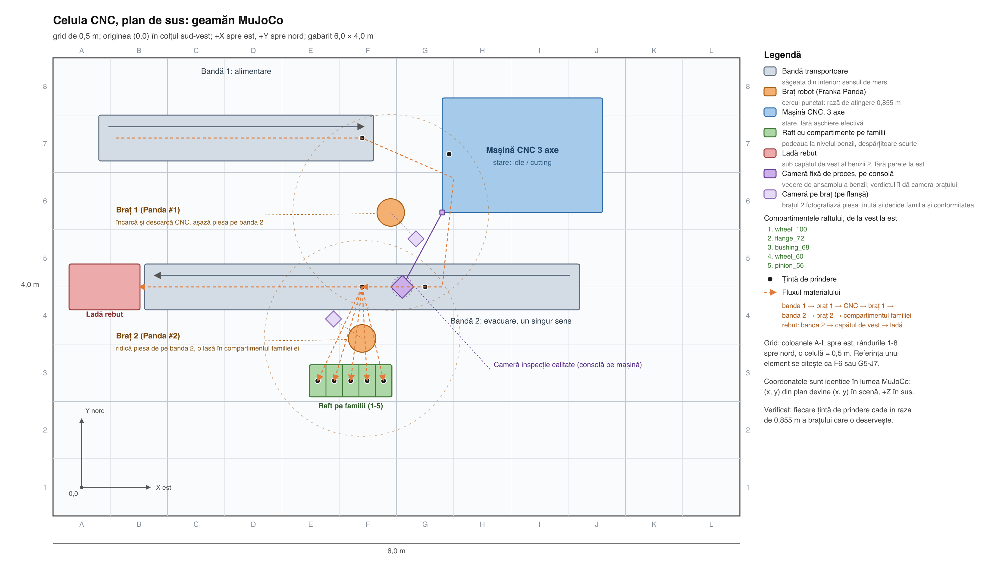

# Geamăn digital MuJoCo: telemetrie pentru antrenare

Plan de implementare pentru al doilea geamăn al celulei CNC. Decizia arhitecturală stă în
[ADR 0012](adr/0012-geaman-mujoco-pentru-generare-de-telemetrie.md); documentul de față spune
**ce** se construiește, în ce ordine și cum se verifică.

Stare: faza 0 (documentația) s-a terminat, iar din faza 2 există scena MJCF din
`simulation/mujoco/`, cu piesa generată, cele două brațe și camera de inspecție, plus transportul
pe benzi (`belt.py`, `cell.py`) cu linie de oprire în plan. Verificarea scenei, `view.py --check`,
este **verde**: țintele cad în raza brațelor, camera de inspecție are piesa în cadru la 3,6 px/mm și
rămâne la peste 5 cm de brațe pe configurațiile eșantionate, iar amândouă piesele parcurg banda la
viteza de suprafață și se opresc la 13 mm peste linia de oprire a benzii. Din faza 2 lipsesc
prinderea, stările mașinii și
`run.py`; testele geamănului și țintele Makefile sunt scrise. Starea amănunțită stă în
`simulation/mujoco/README.md`.
Uzura, telemetria, detectorul, interfața de control și randarea degradată sunt deocamdată doar
pe hârtie.

## Cuprins

1. [Scop și non-scop](#1-scop-și-non-scop)
2. [Scena: componente și reprezentarea în MJCF](#2-scena-componente-și-reprezentarea-în-mjcf)
3. [Motorul de uzură](#3-motorul-de-uzură)
4. [Telemetrie și contracte](#4-telemetrie-și-contracte)
5. [Detecția anomaliilor și timpul de anticipare](#5-detecția-anomaliilor-și-timpul-de-anticipare)
6. [Interfața de control](#6-interfața-de-control)
7. [Structura de fișiere](#7-structura-de-fișiere)
8. [Faze și criterii de acceptare](#8-faze-și-criterii-de-acceptare)
9. [Riscuri și capcane](#9-riscuri-și-capcane)
10. [Decizii lăsate deschise](#10-decizii-lăsate-deschise)

## 1. Scop și non-scop

**Scop.** O celulă CNC simulată care rulează headless, pe CPU, ore întregi, și scoate două
lucruri: telemetrie brută compatibilă cu hot path-ul și ferestre gata de antrenare pentru un
detector de anomalii. Uzura este non-liniară, produce eșecuri mecanice reale în simulare, iar
episoadele de eșec sunt etichetate, ca să se poată măsura un preaviz.

**Non-scop.** Fidelitatea vizuală, interfața operatorului (rămâne Isaac Sim, cu DCV și WebRTC),
fizica așchierii, înlocuirea pipeline-ului existent, orice resursă AWS nouă.

## 2. Scena: componente și reprezentarea în MJCF

Fiecare componentă din promptul de cerință are corespondent în MJCF. MuJoCo nu are bandă
transportoare nativă, deci banda este un geom de tip cutie cu frecare mică, peste care un modul de
forțe tangențiale împinge corpurile aflate în contact cu ea; banda își scoate forța la o cotă din
plan, chiar ținta de preluare, iar de acolo piesa alunecă 13 mm până o oprește frecarea. Capcana
măsurată: cu frecare mare pe platformă, frecarea statică anulează
forța aplicată și piesa stă pe loc, deci platforma are `priority="1"` și frecare mică, iar aderența
benzii o dă exclusiv forța exterioară.

| Componentă | Reprezentare MJCF | Senzori | Actuatori / forțe |
| --- | --- | --- | --- |
| Bandă 1 (alimentare) | cutie (platformă cu frecare mică și prioritară, șine cu frecare mare), fără opritor: piesa se așază în amonte și banda o împinge până la linia de oprire din plan | viteză de suprafață, alunecare, număr de piese | forță tangențială per pas, aplicată prin `data.xfrc_applied` corpurilor în contact, cu limita `mu * N` |
| Braț 1, deservirea mașinii | Franka Emika Panda (7 DoF + griper) din `mujoco-menagerie`; preia piesa de pe banda 1, o încarcă în CNC, apoi o descarcă și o așază pe banda 2 | efort/curent pe articulații, forță de strângere, contact cu piesa | `position`/`motor` pe articulații, actuator pe degetele griperului |
| Mașină CNC, 3 axe | 3 articulații prismatice (X, Y, Z) + corp de ax + piesă prinsă; stările din contract, fără așchiere | vibrație RMS și vârf, sarcină ax, temperatură, avans | profil de sarcină și vibrație aplicat ca forță pe corpul axului, în funcție de stare și uzură |
| Braț 2 (sortare) | același model Panda, pe latura sudică a benzii 2, cu raftul de partea cealaltă | ca la brațul 1 | ca la brațul 1 |
| Bandă 2 (evacuare) | ca banda 1, cu un singur sens de mers, spre vest, și linia ei de oprire la ținta de preluare a brațului 2 | viteza, numărul de piese | ca la banda 1 |
| Raft pe familii | un blat de 0,72 × 0,28 m cu fața de sus la nivelul suprafeței benzii, despărțit în cinci compartimente, câte unul pentru fiecare familie de piese din generator; buzunarele se deschid spre brațul 2, iar piesa se lasă de sus, pe blat + piste de numărare pe compartiment | numărul de piese pe compartiment | — |
| Ladă rebut | o ladă pe podea, sub capătul de vest al benzii 2, cu trei pereți scurți și latura de est deschisă; piesa neconformă rămâne pe bandă, trece de linia de oprire a brațului 2 și cade de la capătul benzii | numărul de rebuturi | — |
| Camere | o cameră fixă de inspecție a calității, deasupra benzii 2, înainte de brațul 2 (rolul `sorting` din `cnc.qa.snapshot.v1.json`: verdictul ei decide ruta), plus câte o cameră pe flanșa fiecărui braț, pentru prindere | cadru RGB offscreen + scor de calitate | — |

Stările mașinii CNC sunt exact enumerația din `cnc.telemetry.v1.json`: `IDLE`, `LOADING`,
`CUTTING`, `UNLOADING`, `INSPECTING`. Ciclul complet — bandă 1 → braț 1 → CNC → braț 1 →
bandă 2 (inspecție) → braț 2 → compartimentul familiei — produce `cycle_id` și `part_id` cu
aceleași formate (`cyc-000001`, `part-000001`).

Randarea camerei se face cu `mujoco.Renderer`. Pentru sesiunile în care interesează doar
telemetria, randarea se oprește complet, iar degradarea imaginii se aplică doar cadrelor cerute
(inspecție), ca să nu plătească timp de generare. Verificat: randarea offscreen funcționează
fără fereastră, pe CPU, în afara Kit.

**Rezoluția nu poate rămâne la implicitul de 160×120.** Diferența cea mai grosieră de rezolvat
este adâncimea unui dinte ciobit, `chip_depth = 4 mm`, iar cea mai fină este dezaxarea radială a
unei găuri, 2,5 mm. Ca fiecare să treacă de câțiva pixeli, piesa de ~100 mm trebuie să ocupe
câteva sute de pixeli, adică ~3,6 px/mm. Cu camera la 2,20 m, cât prevede documentul pentru
celelalte camere, un obiectiv normal acoperă ~1,5 m din cadru: piesa ajunge la vreo 10 pixeli,
iar defectul sub un pixel, deci nicio clasă din catalogul de defecte nu ar fi separabilă. De
aceea acoperirea este fixată, iar distanța și obiectivul se aleg împreună: camera de inspecție
randează la 640×480, cu **9° pe verticală**, de la **0,85 m** deasupra suprafeței benzii 2, deci
acoperă 178 × 134 mm la nivelul benzii — destul ca un dinte ciobit de 4 mm să iasă pe ~14 pixeli
și o gaură dezaxată cu 2,5 mm pe ~9. Sub ~0,3 mm nu se mai măsoară nimic, iar blurul din
secțiunea 3 se adaugă peste.

De ce nu mai jos: pe plaja articulațiilor, geomele unui braț urcă peste axa benzii 2 până la
~1,63 m în lume, adică ~0,78 m peste suprafața benzii, iar capul optic stă deasupra lor, la
1,70 m, pe o consolă prinsă de mașină. Cu capul la 1,60 m golul minim față de brațul 2 ar fi
−0,022 m, adică suprapunere; la 1,70 m este +0,034 m, măsurat pe 2000 de configurații.
Înălțimea camerelor este parametru, nu o constantă comună, iar intrinsics-urile camerei de
inspecție — înălțime, câmp vizual, rezoluție — se scriu în `simulation/mujoco/README.md`,
împreună cu ce poate și ce nu poate rezolva. Legătura cu uzura: degradarea camerei din secțiunea 3 aplică blur proporțional cu
`1 - h_camera`, deci o cameră proiectată exact la limita de rezoluție pierde piesa, nu doar
defectul.

### Poziționarea în celulă: grid de 0,5 m



Celula are 6,0 × 4,0 m, cu originea (0, 0) în colțul sud-vest, **+X spre est** și **+Y spre
nord**. Gridul are celule de 0,5 m: **coloanele A–L** spre est, **rândurile 1–8** spre nord, deci
fiecare element are o referință scurtă — brațul 1 stă în `F6`, mașina ocupă `G6–J8`, banda 2 în
`B4–J5`, brațul 2 în `F4`, raftul pe familii în `E3–F3`, lada de rebut în `A4–B5`, iar axul optic
al camerei fixe în `G5`, cu consola prinsă în colțul `G5` al mașinii.
Conversia la lumea MuJoCo este identitatea: planul `(x, y)` devine lumea
`(x, y)`, cu +Z în sus, deci scena preia cifrele ca atare.

Desenul și tabelele de mai jos ies din aceeași listă de coordonate
(`docs/diagrams/cell_layout.py`), regenerată cu `make cell-layout`; nimic nu se transcrie manual,
ca planul și scena să nu se poată contrazice.

| Element | Centru (x, y) | Amprentă (m) | Celule de grid |
| --- | --- | --- | --- |
| Bandă 1 (alimentare) | (1,60, 3,30) | 2,4 × 0,4 | A7–F7 |
| Braț 1 (Panda #1) | (2,95, 2,65) | bază 0,25 Ø | F6 |
| Cameră pe brațul 1 (flanșă) | (3,17, 2,42) | punct | G5 |
| Mașină CNC 3 axe | (4,10, 3,15) | 1,4 × 1,0 | G6–J8 |
| Bandă 2 (evacuare, un singur sens) | (2,70, 2,00) | 3,8 × 0,4 | B4–J5 |
| Braț 2 (Panda #2) | (2,70, 1,55) | bază 0,25 Ø | F4 |
| Cameră pe brațul 2 (flanșă) | (2,45, 1,72) | punct | E4 |
| Raft pe familii (5 compartimente) | (2,60, 1,18) | 0,7 × 0,3 | E3–F3 |
| Ladă rebut | (0,45, 2,00) | 0,6 × 0,4 | A4–B5 |
| Cameră fixă de proces (consolă pe mașină) | (3,05, 2,00) | ax optic, cadru 0,18 m | G5 |

Fiecare țintă de prindere cade în raza de 0,855 m a brațului care o deservește, măsurată în plan:

| Braț | Țintă | Distanță în plan (m) | În raza de 0,855 m |
| --- | --- | --- | --- |
| Braț 1 | preluare de pe banda 1 | 0,70 | da |
| Braț 1 | încărcare/descărcare CNC | 0,72 | da |
| Braț 1 | așezare pe banda 2 | 0,72 | da |
| Braț 2 | preluare de pe banda 2 | 0,45 | da |
| Braț 2 | compartimentul 1 (wheel_100) | 0,54 | da |
| Braț 2 | compartimentul 2 (flange_72) | 0,44 | da |
| Braț 2 | compartimentul 3 (bushing_68) | 0,38 | da |
| Braț 2 | compartimentul 4 (wheel_60) | 0,37 | da |
| Braț 2 | compartimentul 5 (pinion_56) | 0,42 | da |

Fluxul materialului, desenat punctat pe plan: banda 1 intră din `A7` spre est și lasă **blocul
brut** — un disc de metal, nu piesa finită — la capătul ei, în `F7`; brațul 1 îl ridică și îl
încarcă în mașină pe fața vestică. Abia după ce piesa este poziționată în dispozitiv intră
generatorul procedural: geometria de pe masa mașinii devine roata dințată a familiei, cu clasa ei
de defect, iar eticheta iese din același `GearParams` care a produs geometria, deci nu se pot
desincroniza. După ce mașina termină, brațul 1 o descarcă tot el și o așază pe banda 2, în `G5`,
la o rotație aleatoare. Banda 2 merge într-un singur sens, spre vest, iar pe drum piesa trece pe
sub camera fixă de proces, al cărei ax optic stă peste bandă în `G5`. Brațul 2, aflat pe latura
sudică a benzii, în `F4`, o ridică din `F5` și o lasă în compartimentul familiei ei, pe raftul din
`E3–F3`, cu podeaua la 0,85 m, adică la nivelul suprafeței benzii.

Raftul înlocuiește cutiile adânci de dinainte, și înlocuirea rezolvă o măsurătoare, nu doar o
preferință. Cutiile aveau pereți care urcau până la 0,85 m, nivelul benzii, iar antebrațul brațului
2 trecea prin ei: la cota documentată a piedestalului, 0,55 m, punctele de așezare rămâneau la
41 mm, respectiv 106 mm eroare. Un raft deschis, cu despărțitoare de 50 mm și cu latura de nord
liberă, nu opune nimic antebrațului, iar cele cinci compartimente cad între 0,37 m și 0,54 m de
baza brațului 2 — mai comod decât cutiile, care ajungeau la 0,78 m. Compartimentul cel mai lat are
0,144 m, deci cea mai mare piesă, Ø104, are circa 20 mm joc de fiecare parte.

Fiecare compartiment ține o familie de piese, în ordinea din plan (`docs/diagrams/cell_layout.py`)
și din generator (`cnc_cell/parts/gear.py`): `wheel_100`, `flange_72`, `bushing_68`, `wheel_60`,
`pinion_56`. Un test verifică potrivirea celor două ordini, ca raftul să nu ajungă să adune
familiile în altă ordine decât le învață clasificatorul. Codurile citite de pe raft sunt amânate
deliberat: vezi `docs/10-dataset-piese.md`.

Rebutul are o cale fără braț, ca în plan: piesa neconformă rămâne pe bandă, trece de linia de
oprire a brațului 2 și cade de la capătul de vest al benzii 2 în lada din `A4–B5`. Marginea lăzii
stă la 0,62 m, sub nivelul benzii, ca piesa să nu se sprijine pe perete, iar latura de est nu are
perete deloc: e chiar sub capătul benzii, iar un perete acolo ar prinde piesa. Pistonul de
rejecție din scena Isaac Sim nu se dublează aici — banda duce rebutul până la capăt, fără ca
vreun braț să-l atingă.

Rotația aleatoare de pe banda 2 nu este un detaliu de fizică, ci o decizie despre dataset: dă
clasificatorului de calitate aceeași piesă din unghiuri diferite, iar defectele din catalog sunt
diferențe relative între dinți și cercul de găuri, deci rămân vizibile la orice rotire. Yaw-ul
așezării se loghează însă împreună cu cadrul și cu eticheta, altfel nu se poate construi o
partiție de evaluare pe unghiuri nevăzute și nu se poate distinge invarianța la rotire de noroc.

Înălțimile propuse, pentru când se scrie MJCF-ul: suprafețele de lucru ale benzilor la 0,85 m,
masa mașinii la 0,75 m, capacul de protecție la 1,90 m, podeaua raftului pe familii la 0,85 m,
adică la nivelul suprafeței benzii 2, marginea lăzii de rebut la 0,62 m, adică sub nivelul benzii,
ca piesa să treacă peste ea, baza brațelor pe piedestal la 0,55 m, camerele la 2,20 m,
orientate în jos — cu o excepție, camera de inspecție a calității, al cărei cap optic stă la
1,70 m, adică 0,85 m deasupra benzii 2, pe o consolă care se așază pe capacul mașinii. Culoarele
libere: 0,60 m între capătul benzii 1 și fața vestică a mașinii, 0,45 m între marginea nordică a
benzii 2 și fața sudică a mașinii (brațul 1 lucrează pe deasupra benzii, nu prin culoar), 0,25 m
între marginea sudică a benzii 2 și axul brațului 2, adică 0,13 m până la piedestalul lui, iar de
acolo 0,37 m până la raft. Brațul 1 are 0,72 m până la axul mașinii și 0,72 m până la locul de
așezare pe banda 2, iar brațul 2 are 0,45 m până la punctul de preluare și între 0,37 m și 0,54 m
până la compartimentele raftului. Ambele brațe lucrează pe deasupra benzilor, nu prin culoarele
dintre ele; distanța mică dintre axul brațului 2 și banda 2 se verifică la montaj, în scenă, nu
din plan.

Ce nu spune planul: înălțimile relative dintre brațe și ținte (raza de 0,855 m este proiectată în
plan, deci o țintă poate părea la îndemână și să fie prea sus) și geometria interioară a mașinii.
Amândouă se verifică abia în scenă, la faza 2. Verificarea din scenă prinde o atingere, nu și o
traiectorie care trece razant pe deasupra.

Piedestalul brațelor este cota care nu se poate decide din plan, iar scena o măsoară. Cutiile
adânci de dinainte dădeau sentința „0,55 m nu se poate": pereții lor urcau până la 0,85 m, iar
antebrațul trecea prin ei (`arm2_link3↔bin_ng`), cu 41 mm eroare rămasă la cutia de piese bune.
Raftul deschis scoate exact acea piedică: la 0,55 m, toate cele cinci compartimente se ating cu
1,2–5,5 mm eroare, iar falcile doar se sprijină pe blat. Nu scoate însă piedica de la preluare: ca
să ridice piesa de pe banda 2, brațul 2 trebuie să treacă cu antebrațul peste platformă, iar la
0,55 m platforma este deasupra lui — măsurat, `arm2_link3↔belt_out` la punctul de deasupra, cu
106 mm eroare rămasă. La 0,95 m ciclul se încheie la 17,7 mm eroare maximă, fără nicio verigă
atinsă, iar compartimentele raftului se ating cu sub 6 mm; în schimb anvelopa brațelor cuprinde
capul camerei fixe, care stă la 1,70 m chiar deasupra axei benzii 2 (gol minim eșantionat: −35 mm
față de brațul 1, −22 mm față de brațul 2). Cota documentată rămâne 0,55 m până se decide
(secțiunea 10), iar `make mj-demo MJ_BASE_Z=0.95` rulează ciclul cu brațele ridicate, pentru
măsurători.

## 3. Motorul de uzură

Cod pur, fără MuJoCo, ca să poată fi testat și reproductibil. Cinci mecanisme:

**a) Sănătate cu rată de uzură crescătoare.** Pentru fiecare componentă `i`, sănătatea
`h_i ∈ (0, 1]` pornește de la 1 și scade cu

```
dh_i/dt = -k_i · (1 + α_i · u_i) · h_i^{p_i},   u_i = sarcina normalizată, p_i ∈ (0, 1)
```

Exponentul `p_i < 1` face uzura lentă la început și accelerată spre avarie, adică exact
comportamentul non-liniar cerut. Constantele `k_i` se aleg pe timpi nominali, nu pe valori de
catalog: la sarcină nominală, CNC-ul ajunge la „degradat" în ~30 de minute de așchiere, brațele
în ~90 de minute de mișcare, banda în câteva ore. Toate se scalează dintr-o singură variabilă de
mediu, care comprimă timpul de viață fără să atingă ceasul (ADR 0007).

**b) Drift de calibrare.** `drift_i = d_i · (1 - h_i)`, aplicat ca abatere lentă: viteza benzii
scade cu până la 8%, articulațiile capătă un offset de poziție, axele CNC capătă eroare de
poziționare. Driftul este cel care face uzura vizibilă în medii și deviații, nu doar în nivel.

**c) Zgomot dependent de uzură.** `σ_i = σ0_i + s_i · (1 - h_i)`, adăugat peste mărimile
senzorilor (vibrație, curent de articulație, viteză de bandă), cu sămânță fixă.

**d) Eșecuri discrete.** Hazard crescător `λ_i(t) = λ0_i · exp(γ_i · (1 - h_i))`, evaluat per
pas, cu generator cu sămânță. Evenimentele sunt cele cerute: piesa scăpată din griper, blocaj de
ax CNC (mașina trece pe `IDLE` forțat până la reparație), alunecare de bandă. Fiecare eveniment
scrie o linie în jurnalul de evenimente (`ts`, componentă, tip, `h`), care este **eticheta**
pentru detector.

**e) Degradarea camerei.** Blur gaussian cu rază proporțională cu `1 - h_camera`, zgomot aditiv
pe pixel, ocazional cadru lipsă. Scorul de calitate (`1 - (1 - h_camera)` ponderat cu blurul
aplicat) intră în metadatele cadrului.

**Legătura cu fizica**. Uzura nu rămâne o cifră în telemetrie, ci schimbă simularea:

| Componentă | Efect fizic | Ce se vede în date |
| --- | --- | --- |
| Bandă | coeficient de forță tangențială scade cu `h`, viteza reală scade cu driftul | viteză medie și deviație, timpi de ciclu mai lungi |
| Brațe | `gear` redus și `frictionloss` crescut proporțional cu `1 - h` | curent/efort mai mare, cicluri mai lente |
| Griper | forță de strângere și frecare reduse | rată de piese scăpate, evenimente |
| CNC | amplitudinea profilului de vibrație și de sarcină crește, timpul de ciclu crește | `vibration_rms`, `vibration_peak`, `spindle_load_*`, `temp_c_mean` |
| Cameră | blur și zgomot crescătoare | scor de calitate, verzi la inspecția vizuală |

**Acțiuni de operator** (în oglindă cu `degradation/model.py`): `inject_tool_wear`,
`inject_joint_friction`, `replace_tool`, `repair_joints`, plus două noi, locale:
`inject_fault_burst(componentă, magnitudine, durată)` — scade sănătatea brusc și ridică temporar
rata de uzură, scenariul pe care detectorul trebuie să îl prindă — și
`set_wear_rate(multiplier)`, care comprimă sau întinde viața mașinii.

## 4. Telemetrie și contracte

Două ieșiri, amândouă pe contracte existente.

**Eșantion brut, ~10 Hz**, scris în JSONL (și publicabil pe MQTT, pentru paritate cu calea
live), cu exact câmpurile din `telemetry/schemas/cnc.telemetry.v1.json`. Nu se adaugă câmpuri:
schema are `additionalProperties: false`, iar Lambda-ul de feature engineering oricum aruncă
câmpurile din afara contractului.

**Ferestre de 60 s**, scrise în Parquet (sau CSV pentru inspecție rapidă), cu exact cele 26 de
coloane din `cncdt_ml.schema.ENRICHED_COLUMNS`, produse de funcțiile existente
`cncdt_ml/features.py::compute_window_features` și `enriched_record`. Partiționarea pe disc
respectă `dt_year/dt_month/dt_day/dt_hour`, ca fișierele să poată fi citite cu aceleași
interogări Athena ca datele din lake.

Două mărimi nu au coloană în contract: uzura benzii de alimentare și calitatea camerei. Pentru
bandă se emit eșantioane brute normale, cu `device_id` propriu
(`cnc-cell-01-conveyor`), pe câmpurile care există deja. Calitatea camerei rămâne deocamdată în
metadatele locale ale sesiunii, pentru că nu are nicio coloană în contract. Dacă modelul le cere
în lake, urmează bump `1.0.0 → 1.1.0` simultan în tabelul din Terraform, în
`telemetry/schemas/` și în `cncdt_ml/schema.py` — cele trei se schimbă împreună, altfel
Firehose cade la conversia Parquet.

Fișierele unei sesiuni:

```
runs/<scenario>/<seed>/
  samples.jsonl        # eșantioane brute, 10 Hz
  windows.parquet      # ferestre de 60 s, coloanele din contract
  events.csv           # etichete: momentul eșecurilor și al injectărilor
  wear.csv             # traiectoria sănătății per componentă (diagnostic)
  session.json         # parametrii, versiunea mujoco, sămânța, durata simulată
```

## 5. Detecția anomaliilor și timpul de anticipare

**Vectorul de caracteristici** este cel din contract, plus mărimi strict locale, disponibile
pentru experiment: `spindle_load_mean/p95/std`, `vibration_rms/peak/std`, `tool_wear_index`,
`joint_friction_index`, `coolant_flow_lpm`, `temp_c_mean`, `axis_feed_mean`,
`joint_effort_mean/max`, `sample_count`, `machine_state`, plus `cycle_time_s` și
`belt_speed_std`, care există în simulare și nu în schema publicată.

**Antrenare**: RCF local, doar pe ferestre din sesiuni sănătoase, cu aceleași hiperparametri
pentru toate componentele. **Scor**: fiecare fereastră nouă primește un scor de anomalie.
**Alarmă**: scor peste percentila 99 a distribuției sănătoase, pe două ferestre consecutive.

**Evaluare pe episoade etichetate**, raportată ca tabel, nu ca impresie:

| Metrică | Definiție | Țintă |
| --- | --- | --- |
| Preaviz median | `t(eșec) - t(alarmă)`, în secunde de ceas real | ≥ 120 s |
| Rată de detecție | episoade cu alarmă înainte de eșec / episoade totale | ≥ 0,9 |
| Alarmă falsă | alarme pe oră în sesiuni sănătoase | ≤ 1 / 8 h |

Două precizări de onestitate, care se repetă și în `ml/models/`:

1. **RCF nu prezice.** Este un detector nesupervizat de puncte anormale; preavizul vine din
   faptul că traiectoria de uzură este monotonă și lentă, deci fereastra devine anormală cu
   minute înainte ca mașina să cedeze, plus din regula de alarmă. „Cu câteva minute înainte" se
   obține prin proiectarea semnalului de uzură, nu prin algoritm.
2. **Dacă se cere predicție în sens strict**, adică `P(eșec în următoarele H minute)`, modelul
   potrivit este supervizat, pe aceleași ferestre, cu eticheta din `events.csv`. Infrastructura
   de date este aceeași; `ml/src/cncdt_ml/labels.py` există deja pentru partea de etichetare.

Pentru AWS, `mujoco` se înlocuiește cu un export de ferestre în S3: aceleași coloane, același
`$schema`, deci antrenarea SageMaker RCF și inferența din `ml/training/predictive_maintenance/`
și `ml/inference/predictive_maintenance/` se scriu fără să atingă simularea.

## 6. Interfața de control

Vocabularul reutilizează `cnc.control.v1.json` acolo unde există deja comanda
(`inject_tool_wear`, `inject_joint_friction`, `replace_tool`, `repair_joints`, `pause`,
`resume`, `reset`). Comenzile noi — `inject_fault_burst`, `set_wear_rate`, `reset_wear` — sunt
locale geamănului, pentru că schema de control este închisă (`additionalProperties: false`) și
un nume nou acolo cere bump de versiune plus alinierea Lambda-ului de comenzi.

Trei intrări, toate locale:

1. **Consolă (REPL)** — merge headless, în CI, în rulări de noapte: `fault grip cnc 0.4`,
   `repair all`, `rate 20`, `status`.
2. **Viewer MuJoCo** — când există display (macOS de dezvoltare, sesiunea DCV a instanței):
   panou cu butoane pentru injectare, reparație, rată de uzură. Necesită fereastră, deci nu
   rulează în CI.
3. **Endpoint HTTP local** (`127.0.0.1`), pentru scenarii scriptate: aceleași comenzi ca în
   REPL, plus un `GET /status` care întoarce sănătatea componentelor și ultimul scor de anomalie.

Panoul rămâne o unealtă de dezvoltare. Operarea se uită în dashboard-urile CloudWatch (ADR 0005).

## 7. Structura de fișiere

```
simulation/mujoco/          # există
  README.md                # instalare, comenzi, structură, intrinsics, stare cunoscută
  requirements.txt         # mujoco==3.15.0, mujoco-menagerie==2026.10.1, numpy, mapbox_earcut
  view.py                   # --check / --render / --demo / --view, peste scena compusă de cncdt_mj.scene
  scene/cell.xml            # șablonul celulei; cifrele se pun prin substituție, nu stau în el
  cncdt_mj/
    __init__.py             # căile pachetului
    layout.py               # așezarea în plan (din docs/diagrams/cell_layout.py) și înălțimile; fără MuJoCo
    part.py                 # blocul brut și piesa din generatorul procedural; fără MuJoCo
    belt.py                 # direcțiile benzilor, viteza de suprafață, forța cu limita de frecare; fără MuJoCo
    checks.py               # regulile verificării pe nume de corpuri (contacte normale); fără MuJoCo
    moves.py                # punctele de lucru ale fiecărui braț: ordine, apropiere, treceri; fără MuJoCo
    scene.py                # compunerea: cell.xml plus cele două brațe; importă mujoco
    cell.py                 # contactul cu banda, viteza piesei, forța scrisă în data.xfrc_applied; importă mujoco
    arms.py                 # cinematica inversă, urmărirea căii, strângerea; importă mujoco
```

```
simulation/mujoco/cncdt_mj/  # de scris, în fazele 1-5
  wear.py                   # motorul de uzură (pur, numpy)
  faults.py                 # injectare bruscă, reparație, rată de uzură (pur)
  telemetry.py              # eșantion brut + ferestre, pe contract (pur)
  detector.py               # RCF local + regula de alarmă (pur, numpy)
  report.py                 # preaviz, rată de detecție, alarme false (pur)
  camera.py                 # randare offscreen + degradare
  sensors.py                # din MjData în mărimi de proces
  cell.py                   # are transportul pe benzi și ciclul brațelor; lipsesc prinderea, stările mașinii și legarea uzurii de fizică
  control.py                # REPL, endpoint local, punte către viewer
  run.py                    # punctul de intrare: sesiune, scenariu, sămânță, ieșire
tests/unit/
  test_mujoco_scene.py      # există: layout/part/checks fără MuJoCo, înălțimile față de acest document, camera de inspecție; partea care atinge motorul se rulează cu `make mj-test`
  test_mj_wear.py           # non-liniaritate, monotonie, mărginire, reproductibilitate
  test_mj_telemetry.py      # conformitate cu contractul, ferestre, partiții
  test_mj_detector.py       # prag, alarmă susținută, preaviz pe episod sintetic
```

**De ce scena nu se poate scrie declarativ.** MJCF nu poate aduce singur modelele din
`mujoco-menagerie`: `<attach model="...">` nu funcționează în MuJoCo 3.15.0 — încercat cu patru
forme de cale, toate sfârșite cu „could not find model" — iar `modeldir` nu există pe `<compiler>`.
`scene/cell.xml` ține deci doar componentele celulei, iar cele două brațe se atașează programatic,
cu `MjSpec.attach(child, prefix=..., frame=body.to_frame())` și `copy_during_attach = True` pentru
al doilea exemplar. Celula își scrie propriile poziții nominale, fiindcă cele ale modelului copil
se importă și s-ar ciocni între cele două brațe.

Regula din `AGENTS.md` se respectă: identificatorii în engleză, comentariile de design în
română, logica pură separată de cea care atinge motorul de fizică — `layout.py` și `part.py` se
importă din `.venv`-ul proiectului, unde `mujoco` nu există.

## 8. Faze și criterii de acceptare

| Fază | Ce se livrează | Criteriu de acceptare |
| --- | --- | --- |
| 0 | ADR 0012 + documentul de față | revizuite, fără cod |
| 1 | `wear.py`, `telemetry.py`, `report.py` + teste pure | `pytest` verde fără MuJoCo instalat; uzura e monotonă, mărginită și se accelerează la sănătate mică; ferestrele au exact coloanele din contract |
| 2 | `scene/cell.xml`, `belt.py`, `cell.py`, `run.py` | o sesiune de 10 minute simulează un ciclu complet (bandă 1 → braț 1 → CNC → braț 1 → bandă 2 → braț 2 → cutie) fără piese pierdute în geometrie; timpul de generare se măsoară și se notează în README |
| 3 | scrierea sesiunii (JSONL, Parquet, events, wear) | aceeași sămânță produce fișiere identice; un test de paritate compară vectorii de caracteristici cu cei din scena Isaac Sim pe scenariu nominal |
| 4 | `detector.py` + evaluare | tabelul de metrici din secțiunea 5, generat de o comandă, pe minimum 20 de episoade de eșec și 8 ore sănătoase |
| 5 | `control.py` + degradarea camerei | injectarea și reparația din REPL se văd în telemetrie în aceeași fereastră; cadrul de cameră degradat păstrează piesa detectabilă până la `h` critic |
| 6 | (opțional) SageMaker RCF + card de model | antrenare din ferestrele exportate, card în `ml/models/`, cost justificat în PR |

Starea de azi: din faza 2 există partea de scenă — `layout.py`, `part.py`, `checks.py`, `scene.py`,
`scene/cell.xml` și `view.py` —, transportul pe benzi (`belt.py`, `cell.py`, cu linia de oprire din
plan și viewer cu benzile pornite) și **brațele în mișcare**: `moves.py` ține punctele de lucru ale
fiecărui braț, iar `arms.py` le atinge cu cinematică inversă, urmărind linii drepte în spațiul
sculei. `view.py --check` este verde, `view.py --demo` rulează ciclul și tipărește cifrele fiecărei
opriri, iar testele geamănului, `tests/unit/test_mujoco_scene.py`, acoperă partea pură. Criteriul
**nu este atins**: ciclul atinge punctele, dar nu prinde piesa (falcile doar o ating, fiindcă
deschiderea mâinii Panda, 83 mm, este mai mică decât discul de 104 mm — prinderea se modelează ca
legătură rigidă, ca în celula din Isaac Sim), lipsesc stările mașinii CNC și `run.py`, deci „fără
piese pierdute în geometrie" nu se poate dovedi încă.

Fiecare fază se poate opri fără să lase ceva rupt: faza 1 nu are dependențe de MuJoCo, faza 2 nu
atinge contractele publicate.

## 9. Riscuri și capcane

- **Banda cere forțe proprii.** MuJoCo nu are bandă nativă; modulul de forțe tangențiale trebuie
  să fie stabil la pas mare, altfel piesele tremură sau cad prin geometrie. Se validează cu un
  test de transport: o piesă parcurge banda în timpul așteptat, la trei pași de integrare
  diferiți.
- **Determinismul are limite.** Aceeași versiune de MuJoCo, același nucleu, aceeași sămânță dau
  rezultate identice; o altă versiune poate schimba ultimele zecimale. De aceea versiunea se
  fixează în `requirements.txt`, iar `session.json` o notează.
- **Două Python-uri.** Kit (Isaac Sim) și proiectul rulează pe versiuni diferite de Python.
  Geamănul MuJoCo nu se importă din extensia Isaac Sim, nici invers; comunicarea, dacă va fi
  nevoie, se face prin fișiere sau prin rețea.
- **Licențele modelelor.** Modelul Panda din `mujoco-menagerie` este Apache-2.0; fiecare model
  folosit se verifică la adoptare, iar atribuirea se păstrează.
- **Preavizul se măsoară în ceas real.** La 60 s per fereastră, „câteva minute" înseamnă cel
  puțin două ferestre; sesiunile de evaluare trebuie să dureze real sau să folosească o rată de
  uzură mărită, cu mențiunea explicită în raport.
- **Divergența dintre geamănuri.** Cel mai probabil mod de a strica proiectul este să ajustezi
  uzura într-un geamăn și să uiți celălalt. Testul de paritate din faza 3 este plasa de
  siguranță; dacă el cade des, semnul este că motoarele trebuie unificate.
- **Volumul de date.** 10 Hz × 6 dispozitive ≈ 5,2 milioane de eșantioane pe zi. Parquet cu
  compresie și partiționare pe oră ține lucrurile rezonabile, dar sesiunile de noapte se
  planifică pe disc, nu pe bunăvoință.

## 10. Decizii lăsate deschise

1. **Unificarea motoarelor de uzură** (geamăn MuJoCo și extensia Isaac Sim) — se decide după
   faza 3, când contractul de caracteristici e dovedit stabil.
2. **Bump de schemă pentru uzura benzii și calitatea camerei** — se decide după faza 4, în
   funcție de dacă detectorul le cere în lake.
3. **Predicție supervizată peste RCF** — se decide după faza 4, când se vede cât preaviz dă
   detecția nesupervizată.
4. **Paralelizare pe GPU (MJX sau MuJoCo Warp)** — se decide când timpul de generare devine
   limita reală a antrenării.
5. **Cota piedestalului brațelor** — raftul a scos piedica pe care o puneau cutiile (la 0,55 m,
   toate cele cinci compartimente se ating cu 1,2–5,5 mm eroare), dar a rămas banda 2: ca să ridice
   piesa de pe ea, brațul 2 trebuie să treacă cu antebrațul peste platformă, iar la 0,55 m
   platforma este deasupra lui (`arm2_link3↔belt_out`, 106 mm eroare). La 0,95 m ciclul se încheie
   la 17,7 mm eroare maximă, iar compartimentele se ating cu sub 6 mm; în schimb camera fixă de la
   1,70 m cade în anvelopa brațelor (−35 mm față de brațul 1, −22 mm față de brațul 2, la
   eșantionare). Cota se decide împreună cu locul camerei fixe, înainte de a lega uzura de fizică:
   poziția camerei este și ea o mărime din telemetrie.
