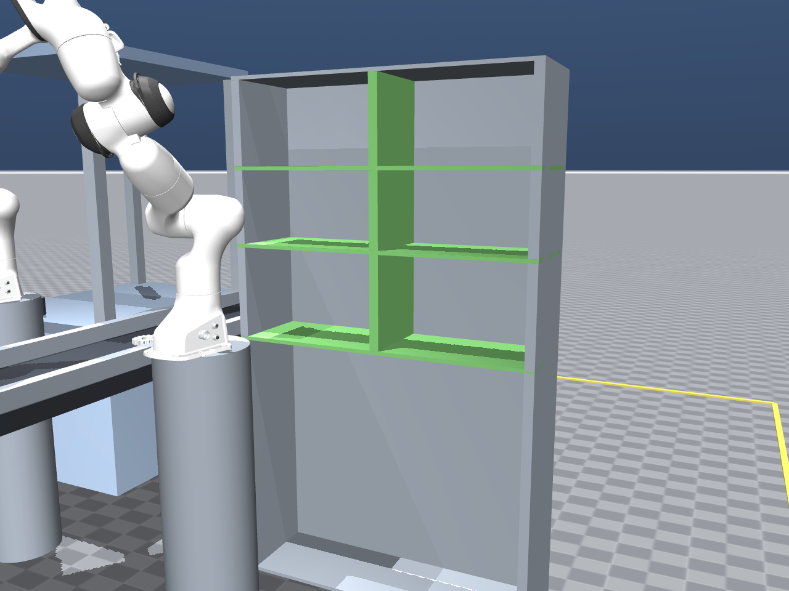
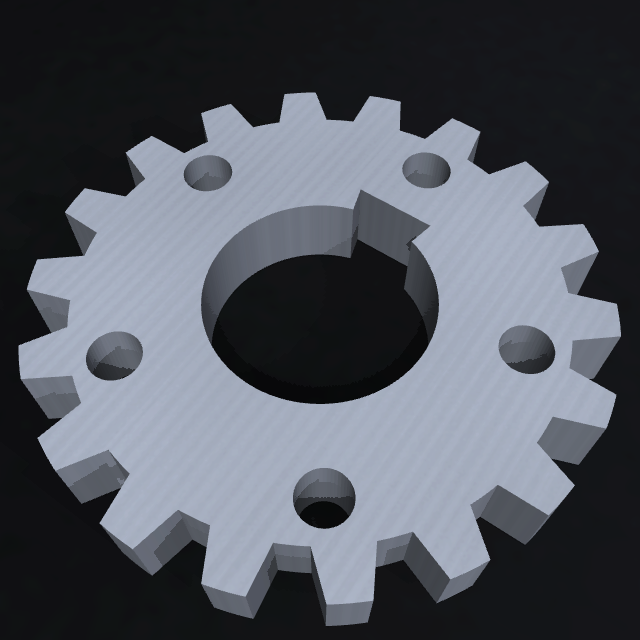
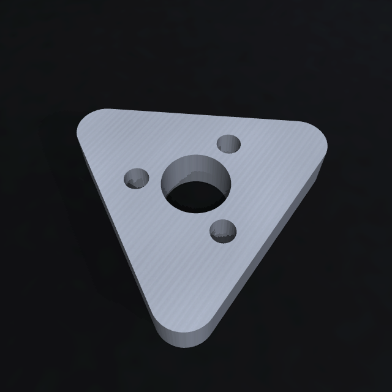
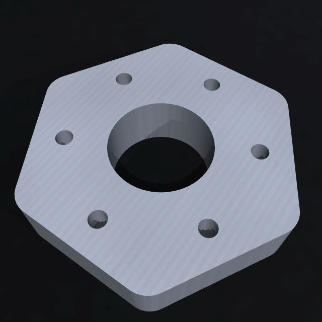
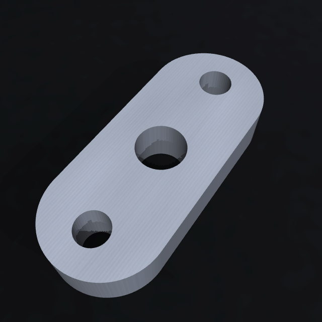
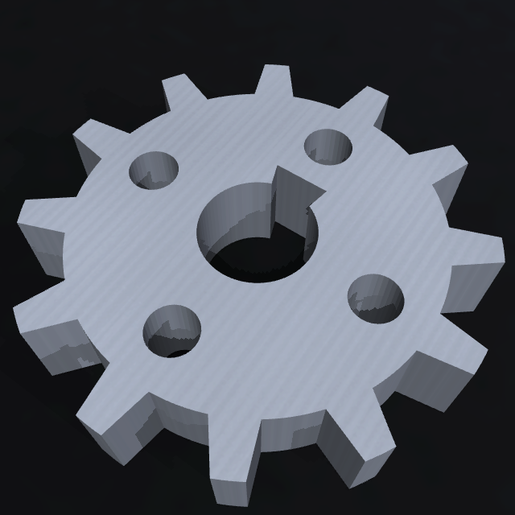
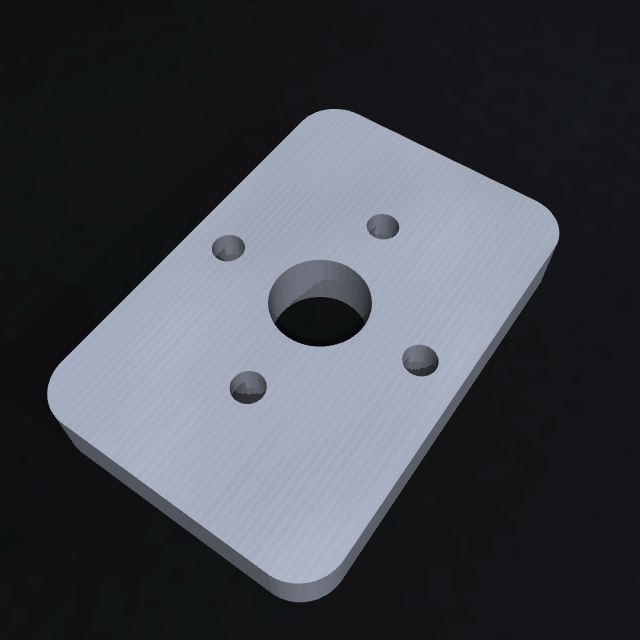

# Geamănul MuJoCo al celulei CNC

A doua implementare a celulei, lângă cea din Isaac Sim: aceeași celulă, alt motor de fizică, ca
scopul ei real — ore de telemetrie brută și ferestre de antrenare pentru detectorul de anomalii —
să ruleze pe CPU, în afara Kit, fără instanță GPU. Decizia și consecințele ei sunt în
`docs/adr/0012-geaman-mujoco-pentru-generare-de-telemetrie.md`; descrierea celulei, înălțimile și
fluxul materialului sunt în `docs/11-geaman-mujoco.md`, care rămâne sursa de adevăr.

Directorul nu conține modele de roboți: brațele vin din pachetul `mujoco-menagerie`, iar piesa din
generatorul procedural existent, `simulation/extensions/cncdt.cnc_cell`. Nimic nu se copiază în
repo.

## Instalare

Mediul este separat de `.venv`-ul proiectului (ADR 0012, decizia 7) și este ignorat de git:

```bash
python3 -m venv simulation/mujoco/.venv
simulation/mujoco/.venv/bin/python -m pip install -r simulation/mujoco/requirements.txt
```

Verificat pe macOS arm64, Python 3.14.6, `mujoco==3.15.0`, `mujoco-menagerie==2026.10.1`.

## Comenzi

Din rădăcina repo-ului, țintele Makefile acoperă tot ce se rulează des:

```bash
make mj-venv     # o singură dată: creează venv-ul geamănului și instalează requirements.txt
make mj-check    # poarta: compilează scena, măsoară, raportează; iese cu 1 dacă ceva cade
make mj-test     # testele geamănului care ating motorul, din venv-ul lui
make mj-render   # scrie renders/cell.png și renders/arm2_wrist_camera.png
make mj-demo     # rulează ciclul celulei, cu prindere fizică, și tipărește cifrele fiecărei opriri
make mj-view     # deschide viewer-ul cu ciclul celulei și panoul de uzură/reparații
make mj-record   # colectează sesiuni de antrenare, câte una pe familie, în runs/
make mj-collect  # colectează (MJ_COLLECT_CYCLES cicluri pe familie) și urcă în bucketul data lake
make mj-collect-plan   # tipărește ce ar urca `make mj-collect`, fără să atingă bucketul
make mj-publish  # urcă în bucket sesiunile deja scrise în runs/
make mj-modal-collect  # cadre pe GPU T4, containere paralele, urcate în bucket
make mj-modal-plan     # tipărește ce ar lansa țintele Modal, fără să lanseze nimic
make mj-parts-dataset  # manifest + imagini de calitate ale pieselor, local
make mj-parts-images   # doar imaginile, din manifestul existent
make mj-modal-parts    # datasetul de piese pe GPU-uri Modal, urcat în bucket
make mj-demo MJ_FAMILIES="wheel_100 pinion_56"   # doar familiile cerute, ca proba să fie scurtă
make mj-record MJ_RECORD_CYCLES=20   # sesiune de antrenare: 20 de cicluri pe familie
make mj-collect MJ_COLLECT_CYCLES=20 MJ_COLLECT_SEED=100   # colectare lungă, urcată direct
make mj-collect MJ_COLLECT_FRAMES=false   # doar senzori: uzura nu are nevoie de poze
make mj-modal-collect MJ_MODAL_CYCLES=500 MJ_MODAL_SESSIONS=2   # ore de viață de mașină
```

`make mj-collect` are nevoie de `DATA_LAKE_BUCKET` în `.env` (ieșirea `bucket_name` a
stack-ului `training-data`) și de credențialele rolului de operator, luate cu
`eval "$(./scripts/assume-operator.sh)"`. Fără ele, refuză înainte să atingă bucketul.

`make mj-modal-collect` lansează aceeași colectare pe **Modal**, într-un container pentru fiecare
sesiune, toate în paralel, și nu are nevoie de credențiale locale: containerele primesc un token de
identitate, pe care îl schimbă pe credențiale temporare ale rolului `cncdt-<mediu>-modal-collector`
(ADR 0015). Are nevoie de CLI-ul `modal` autentificat și de secretul `cncdt-aws`, pe care îl
creează comanda dată de `make training-data-status`.

Sesiunile cu cadre rulează pe un GPU T4, cu `MUJOCO_GL=egl`, și scriu **doar cadrele**
(`run.py --only-frames`): `frames/`, `frames.jsonl` și `session.json`, fără telemetrie, fiindcă
aceasta are deja corpusul ei. Rezultatul urcă sub `training-data/grasp/` prin
`publish_frames.py`; `--no-upload` păstrează proba doar în volumul Modal. `MJ_MODAL_FRAMES=false`
readuce colectarea de senzori pe CPU, iar
`MJ_MODAL_TELEMETRY=true` adaugă telemetria la sesiunea cu cadre și urcă sub
`training-data/mujoco/`. Datasetul de imagini de calitate ale pieselor se produce separat, cu
`make mj-modal-parts`, și urcă sub `training-data/parts/`.

Fără Makefile, aceleași lucruri se scriu direct:

```bash
MUJOCO=simulation/mujoco/.venv/bin/python

# Verificarea implicită: compilează scena, așază piesele, rulează pași, raportează cifrele.
$MUJOCO simulation/mujoco/view.py --check

# Ciclul celulei, cu prindere fizică: eroarea, unghiul, contactele, prinderile și unde au ajuns
# piesele.
$MUJOCO simulation/mujoco/view.py --demo

# Același ciclu, cu un PNG la fiecare oprire, în renders/demo/ (director generat, ignorat de git).
$MUJOCO simulation/mujoco/view.py --demo --shots

# Sesiunea de colectare: telemetrie, cadre, metadate și etichete, în runs/<familie>-<sămânță>/.
$MUJOCO simulation/mujoco/run.py --cycles 2
$MUJOCO simulation/mujoco/run.py --family pinion_56 --cycles 20 --out /tmp/sesiune
$MUJOCO simulation/mujoco/run.py --cycles 5 --no-frames   # doar telemetrie, mult mai rapid
$MUJOCO simulation/mujoco/run.py --cycles 5 --rate 50     # viața mașinii comprimată de 50 de ori
$MUJOCO simulation/mujoco/run.py --cycles 2 --inject belt_out:0.5 --inject cnc_tool:0.7

# Ruta piesei de pe banda 2: `rack` (implicit) o lasă în compartimentul familiei, `scrap` forțează
# rebutul pe bandă, iar `vision` cere verdictul endpoint-ului pe cadrul de sortare.
$MUJOCO simulation/mujoco/run.py --cycles 1 --route scrap
$MUJOCO simulation/mujoco/run.py --cycles 1 --route vision   # cere endpoint-ul și credențiale AWS

# Un cadru al celulei, din camera liberă (implicit renders/cell.png).
$MUJOCO simulation/mujoco/view.py --render

# Cadrul camerei de pe flanșa brațului 2, la rezoluția ei nativă (renders/arm2_wrist_camera.png).
$MUJOCO simulation/mujoco/view.py --render --camera arm2_wrist_camera

# Viewer interactiv, cu benzile pornite. Pe macOS fereastra se creează doar pe firul principal,
# deci cere `mjpython`, care vine în wheel-ul `mujoco`; semnul că rulăm sub el este variabila
# `MJPYTHON_BIN`, fiindcă `sys.executable` rămâne interpretul din venv.
simulation/mujoco/.venv/bin/mjpython simulation/mujoco/view.py --view

# Aceeași fereastră, cu ciclul celulei în locul benzilor goale: ăsta e modul în care se văd
# brațele mișcându-se, cu prindere.
simulation/mujoco/.venv/bin/mjpython simulation/mujoco/view.py --view --demo

# Ruta din verdictul endpoint-ului: cadrul camerei `arm2_wrist` pleacă la endpoint, iar brațul 2
# alege raftul familiei ori lada de rebut.
simulation/mujoco/.venv/bin/mjpython simulation/mujoco/view.py --view --demo --route vision

# Demonstrația cu alarmă: viewer-ul publică eșantioane în IoT Core din exact modelul de uzură pe
# care îl repară panoul și rămîne deschis după ciclu, ca uzura injectată și reparația să ajungă
# în ferestrele următoare.
simulation/mujoco/.venv/bin/mjpython simulation/mujoco/view.py --view --demo --iot
make mj-view MJ_VIEW_ARGS="--demo --iot"   # aceeași comandă, prin Makefile

# Cu blocul brut lăsat mai în amonte și în reluare lentă, ca transportul până la linia de oprire să
# se vadă (altfel pornește chiar la linia benzii 1). Piesa mașinată stă pe masa de descărcare a
# mașinii, pînă la schimbul de material.
simulation/mujoco/.venv/bin/mjpython simulation/mujoco/view.py \
    --view --speed 0.5 --blank-x 0.6
```

`--check` iese cu cod 1 dacă vreo verificare cade, ca să poată fi folosit ca poartă, iar `--demo`
iese cu cod 1 dacă vreo oprire a ciclului nu ajunge la punct ori dacă o verigă a brațului atinge
celula. Restul opțiunilor: `--steps`, `--seed`, `--defect`, `--family` (familia de piese: alege
piesa, blocul brut, compartimentul din raft și cota de lucru), `--blank-shape`,
`--blank-x`/`--blank-y`,
`--blank-yaw-deg`, `--part-yaw-deg`, `--part-x`/`--part-y`, `--base-z` (cota
piedestalului brațelor, pentru măsurători), `--demo-settle` (câți pași se așteaptă la fiecare
oprire), `--shots [DIR]`,
`--width`, `--height`, iar pentru viewer `--belts`/`--no-belts`, `--speed`, `--route` (`rack`,
`scrap`, `vision`), `--iot`, `--hold`, `--loop`/`--no-loop`, `--view-fps` și
`--panel`/`--no-panel`. La pozițiile cerute explicit, cota care lipsește rămâne cea
din plan: `--blank-x 0.6` mută piesa pe banda 1, fără să ceară și `--blank-y`.

Viewer-ul rulează în ritm real și tipărește în terminal, la fiecare secundă simulată, ce piesă e pe
ce bandă, cu ce viteză și cât mai are până la linia de oprire. `--speed 0` scoate ritmul real, ca
sesiunea să alerge cât poate.

### Panoul de uzură și reparații

Odată cu viewer-ul se deschide o fereastră separată cu butoanele de uzură și reparație. Ea
vorbește cu `view.py` prin linii JSON: comenzile ies pe stdout, iar starea intră pe stdin.

| Buton | Comandă | Efect |
| --- | --- | --- |
| CNC wear +0.1 / +0.25 | `inject_tool_wear` | adaugă la uzura sculei |
| New CNC tool | `replace_tool` | readuce scula la sănătate deplină |
| Arm 1/2 inject +0.25 | `inject_wear` (`arm1`, `arm2`) | adaugă la frecarea unui singur braț |
| Arm 1/2 repair | `repair` (`arm1`, `arm2`) | readuce un singur braț |
| Repair all | `repair_all` | scula și brațele, fără benzi |
| Reset wear | `reset_wear` | toate cele șapte componente și rata de uzură |

Fereastra arată uzura sculei, frecarea fiecărui braț, calitatea suprafeței, eșecurile active și
ultima acțiune. Uzura brațelor și a benzilor curge în timpul simulării; scula se uzează la
așchiere, iar în viewer se injectează din butoane. Fiecare braț se injectează și se repară
separat, iar indicii lui ajung în CloudWatch pe elementele `arm1` și `arm2` (ADR 0026).

```bash
# Panoul pornește implicit. `--no-panel` lasă doar viewer-ul.
simulation/mujoco/.venv/bin/mjpython simulation/mujoco/view.py --view
simulation/mujoco/.venv/bin/mjpython simulation/mujoco/view.py --view --no-panel
```

Pe macOS, Python-ul din venv-ul geamănului nu are Tkinter, deci `view.py` pornește panoul cu
`/usr/bin/python3`; dacă niciun interpret cu Tkinter nu este disponibil, viewer-ul continuă fără
fereastră și scrie motivul în terminal. Panoul este o unealtă de dezvoltare: aceleași comenzi
ajung în producție prin schema de control, fără Tkinter.

Cu `--iot`, eșantioanele viewer-ului pleacă în IoT Core din exact `WearModel` pe care îl repară
panoul, la 10 Hz, cu `machine_state` din faza ciclului și `is_synthetic_defect` din familia și
defectul piesei. `cncdt_mj/iot.py` numără PUBACK-urile, nu doar apelurile paho: jurnalul scrie
`sent`, `acked`, `failed`, `rejected`, starea conexiunii și prima eroare, iar la închidere așteaptă
pînă la 3 s confirmările. Viewer-ul rămîne deschis după ciclu (`--hold`, implicit când `--iot` este
pornit), ca să poți injecta uzură, vedea `DegradationIndex` în CloudWatch și apoi apăsa „Repară
tot”; eșantioanele următoare coboară indicele, iar alarma se stinge la evaluarea următoare. Prima
fereastră Firehose apare în circa un minut. Fără certificatele din `simulation/secrets/`, `--iot`
se oprește cu mesajul care trimite la `simulation/scripts/gen-iot-certs.sh`. La finalul unei
sesiuni `run.py --iot`, clientul se închide întîi, apoi raportează `confirmate/total`, ca cifra să
vină din PUBACK-uri.

Suita proiectului (`make test`) rulează fără `mujoco` și include partea pură a testelor
geamănului, `tests/unit/test_mujoco_scene.py`, plus contractele colectării
(`tests/unit/test_mj_telemetry.py`), motorul de uzură (`tests/unit/test_mj_wear.py`) și corpusul
de antrenare (`tests/unit/test_mj_export.py`); testul care
atinge scena se sare acolo și se rulează cu `make mj-test`, din venv-ul care are motorul.

## Structură

| Fișier | Ce conține |
| --- | --- |
| `cncdt_mj/layout.py` | Așezarea în plan și înălțimile. Coordonatele `(x, y)` **nu** se transcriu: se importă din `docs/diagrams/cell_layout.py`, ca planul și scena să nu se poată contrazice. Înălțimile `Z` se scriu aici, cu fragmentul din documentație de care aparțin. **Fără MuJoCo.** |
| `cncdt_mj/part.py` | Cele două stări ale materialului: blocul brut (disc cu adaos de prelucrare) și piesa din generator (roată ori placă). Geometria iese în milimetri, în planul `XY`, cu grosimea pe `Z`; se scalează în metri. Aici stau și pozițiile de așezare: `stopped_xy` pentru piesa așezată la linia de oprire a benzii, `on_belt_xy` pentru una cerută explicit. **Fără MuJoCo.** |
| `cncdt_mj/belt.py` | Benzile: direcția fiecărei benzi, viteza de suprafață și forța de antrenare cu limita de frecare Coulomb. **Fără MuJoCo.** |
| `cncdt_mj/checks.py` | Regulile verificării care lucrează pe nume de corpuri și pe cifre, nu pe starea motorului (de pildă care contacte ale unui braț sunt normale), plus pragurile verificării, împărțite cu `view.py`. **Fără MuJoCo.** |
| `cncdt_mj/moves.py` | Mișcările: ce puncte deservește fiecare braț, în ce ordine, din ce parte vine scula, cu ce rotire și prin ce puncte de trecere. Cotele punctelor de lucru ies din înălțimile documentate. **Fără MuJoCo.** |
| `cncdt_mj/povs.py` | Punctele de vedere din care se strânge datasetul: camera, rezoluția, momentul de captură (un punct de lucru al ciclului ori un moment al prinderii) și rolul din contract. **Fără MuJoCo.** |
| `cncdt_mj/part_images.py` | Planul imaginilor de calitate: unghiurile fiecărui cadru, distanța camerei, numele și indexul JSON Lines, split-urile train/val/test. **Fără MuJoCo.** |
| `cncdt_mj/textures.py` | Texturi procedurale scrise ca PNG cu numpy și zlib — beton, cauciuc de bandă, metal periat —, ca scena și piesele să nu aibă materiale plate și repo-ul să nu țină binare. **Fără MuJoCo.** |
| `cncdt_mj/part_render.py` | Randatorul unei variante: scena minimă cu plan texturat, piesă de metal periat, trei lumini și camera de sus, apoi PNG-ul. Importă `mujoco`. |
| `cncdt_mj/telemetry.py` | Contractele: eșantionul brut cu exact câmpurile din `cnc.telemetry.v1.json`, metadatele cadrului de inspecție, etichetele sesiunii, plus un validator mic peste fișierele de schemă (fără dependența `jsonschema`). **Fără MuJoCo.** |
| `cncdt_mj/wear.py` | Motorul de uzură: sănătatea celor șapte componente pe timpul lor de lucru, efectele în mărimile din contract, eșecurile discrete cu hazard crescător și acțiunile de operator, cu etichetele lor. **Fără MuJoCo.** |
| `cncdt_mj/control.py` | Comenzile panoului și ale viewer-ului: aceleași nume ca schema de control, plus `reset_wear`; ține `ControlSession` peste motorul de uzură. **Fără MuJoCo.** |
| `cncdt_mj/journal.py` | Inelul de evenimente afișat în viewer și în panou: conexiunea IoT, confirmările brokerului, verdictul endpoint-ului, comenzile operatorului, starea ciclului. **Fără MuJoCo.** |
| `cncdt_mj/pacing.py` | Ritmul de redesenare: pașii de simulare rămîn 500/s, dar viewer-ul desenează `--view-fps` cadre pe secundă, ca GPU-ul să nu țină laptopul fierbinte degeaba. **Fără MuJoCo.** |
| `cncdt_mj/export.py` | Corpusul de antrenare: așezarea cheilor în bucket, manifestul și verificările care opresc urcarea unui corpus cu găuri. **Fără MuJoCo.** |
| `cncdt_mj/scene.py` | Compunerea scenei: `scene/cell.xml` plus cele două brațe atașate programatic, cu camerele de pe flanșe. Unul dintre modulele care importă `mujoco`. |
| `cncdt_mj/cell.py` | Celula în mișcare: cine e în contact cu banda, ce viteză are piesa, ce forță se scrie în `data.xfrc_applied`. Al doilea modul care importă `mujoco`. |
| `cncdt_mj/arms.py` | Brațele: numele articulațiilor și ale actuatoarelor, lungimea sculei măsurată în scenă, cinematica inversă, urmărirea liniei cu orientare interpolată și comenzi rampate, plus strângerea. Importă `mujoco`. |
| `cncdt_mj/grasp.py` | Falcile pe piesă: închidere comandată, contact, legătură `weld` activată la prindere și clema de suprafață, plus raportul fiecărei prinderi. Importă `mujoco`. |
| `cncdt_mj/grasp_cycle.py` | Ciclul complet: transport, preluare, universal, schimb de material, bandă, raft, variație de poziție din sămânță și verificările de la sfîrșit. În flux continuu, încărcarea următorului bloc se înregistrează pe o copie a stării și se redă cît brațul 2 sortează. Importă `mujoco`. |
| `cncdt_mj/sensors.py` | Din starea motorului în mărimi de proces: efortul articulațiilor, forța falcilor, poziția și viteza pieselor, sarcina de contact. Importă `mujoco`. |
| `cncdt_mj/camera.py` | Randarea offscreen: scrierea PNG fără dependențe externe, cadrele știute ale camerei libere și ținerea minte a randatoarelor. Importă `mujoco`. |
| `scene/cell.xml` | Șablonul celulei. Cifrele nu stau în el: se pun prin substituție, din `layout.scene_geometry()`. |
| `view.py` | Cele patru moduri: `--check`, `--render`, `--demo`, `--view`. În viewer, `--route vision` trimite cadrul de sortare endpoint-ului, iar `--iot` publică eșantioanele din modelul de uzură al panoului. |
| `panel.py` | Panoul Tkinter de uzură și reparații, pornit de `view.py --view`; vorbește cu viewer-ul prin linii JSON. |
| `run.py` | Sesiunea de colectare: cicluri întregi, uzura care se acumulează peste ele, telemetrie, cadre, fișierele sesiunii și verificarea lor la sfârșit. `--only-frames` scrie doar cadrele și indexul lor, iar `--route` alege ruta piesei de pe banda 2 (`rack`, `scrap` ori verdictul endpoint-ului, `vision`). |
| `render_parts.py` | CLI-ul imaginilor de calitate: citește manifestul, reconstruiește fiecare variantă și randează cadrele, cu felii pentru containere paralele. |
| `publish.py` | Urcarea corpusului în bucketul data lake, cu AWS CLI: plan fără `--upload`, credențiale de operator, manifest scris la rădăcina rulării. Doar biblioteca standard. |
| `publish_frames.py` | Urcarea doar a cadrelor (`training-data/grasp/`): verifică fiecare rînd al indexului, scrie manifestul rulării. Doar biblioteca standard. |
| `publish_parts.py` | Urcarea datasetului de imagini de calitate (`training-data/parts/`): unește indexurile felilor, verifică etichetele și PNG-urile, scrie manifestul. Doar biblioteca standard. |
| `modal_collect.py` | Aplicația Modal: sesiuni pe CPU sau GPU T4, datasetul de piese pe GPU-uri, identitate federată și urcare directă în bucket. |

Consecința practică a împărțirii: `layout`, `part`, `belt`, `checks`, `moves`, `povs`, `telemetry`,
`textures`, `wear`, `control`, `export`, `journal`, `pacing` și `part_images` se importă din
`.venv`-ul proiectului, unde `mujoco` nu există (ADR 0012), iar tot ce atinge motorul se validează
rulând `view.py --check`. Lista modulelor de motor (`scene.py`, `cell.py`, `arms.py`, `grasp.py`,
`grasp_cycle.py`, `camera.py`, `sensors.py`, `part_render.py`) este scrisă
explicit în `tests/unit/test_mujoco_scene.py`: un modul nou care importă `mujoco` trebuie declarat
acolo, altfel testul cade.

### De ce scena se compune în Python, nu în MJCF

MJCF nu poate aduce singur modelele din Menagerie: atributul `<attach model="...">` **nu
funcționează** în MuJoCo 3.15.0 (încercat cu patru forme de cale), iar `modeldir` nu există pe
`<compiler>`. Deci `scene/cell.xml` ține doar componentele celulei, iar brațele se atașează cu
`MjSpec.attach(child, prefix=..., frame=body.to_frame())` și `copy_during_attach = True` pentru al
doilea braț. Prefixele de nume (`arm1_`, `arm2_`) țin cele două brațe separate, iar celula își
scrie propriile poziții nominale, fiindcă ale modelului copil se importă și s-ar ciocni.

## Ce verifică `--check`

Cifrele de referință, la sămânța implicită 7: scena se compilează fără avertismente MuJoCo,
`nq/nv/nu = 32/30/16`, 31 de corpuri și 206 geome, iar piesele se așază pe benzi cu derivă sub
0,1 mm, cu yaw-ul cerut citit înapoi din scenă (comparat pe cerc, deci 348,5° și −11,5° sunt
același unghi).

Țintele de prindere, măsurate **în spațiu** de la baza brațului, față de raza de 0,855 m din plan:
brațul 1 ajunge la 0,704 m (preluare bandă 1), 0,730 m (mașină) și 0,723 m (așezare bandă 2);
brațul 2 la 0,461 m (preluare bandă 2) și la compartimentele dulapului: 0,721 m și 0,510 m pe
raftul 1, 0,744 m și 0,542 m pe raftul 2, 0,850 m și 0,679 m pe raftul 3.
Planul măsoară doar în plan, iar `docs/11-geaman-mujoco.md` spune
explicit că o țintă poate părea la îndemână în desen și să fie prea sus — verificarea de aici este
cea în spațiu.

Camerele de pe flanșe se verifică față de punctul de strângere: dacă acesta intră în cadru, la ce
adâncime și cu ce abatere față de ax, și câți pixeli iese piesa ținută — pragul
`checks.MIN_WRIST_PART_PX` prinde o montare greșită ori o cameră prea depărtată. Se mai verifică
faptul că niciun braț nu atinge un element al celulei la poziția nominală. Autocontactele unui braț
(`arm1_hand↔arm1_link5`) sunt normale și se ignoră.

## Brațele: ciclul din `--demo`

`--demo` este partea care se vede: piesele sunt aduse întâi la liniile de preluare
(`bring_parts_to_pickup`, cu benzile pornite), apoi ciclul din `grasp_cycle.py` își urmează fluxul —
brațul 1 prinde blocul de pe banda 1, îl lasă în universal, mașina are fereastra ei de așchiere,
schimbul de material scoate piesa mașinată pe masa de descărcare, brațul 1 o duce pe banda 2, banda
o aduce la linia de preluare, iar brațul 2 o așază în compartimentul familiei ei (`--family` alege
familia, deci și compartimentul). Cu `--loop`, imediat după verdict brațul 1 începe încărcarea
următorului bloc, cît brațul 2 își duce piesa la raft; ciclul următor pornește direct la așchiere.
Fără `--family`, `--loop` rotește cele șase familii în ordinea compartimentelor, deci fiecare ciclu
mașinează altă variantă de piesă și o lasă în compartimentul ei: după șase cicluri, raftul arată
toate cele șase forme.
La fiecare oprire se tipăresc eroarea
rămasă (poziție și rotire a sculei), cea mai mare abatere de pe drum, câți pași a durat și
contactele; la fiecare prindere, dacă falcile au atins piesa, deschiderea măsurată și reușita.
Iese cu cod 1 dacă o oprire nu ajunge la punct, dacă o **verigă** a brațului atinge celula ori dacă
o prindere ratează piesa; atingerea falcilor se tipărește fără să fie eșec, fiindcă falcile sunt
scula.

Un punct se atinge așa: `arms.solve_point` caută configurația prin cinematica inversă amortizată pe
jacobianul corpului mâinii, pornind din două sămânțe — comanda curentă și poziția nominală — și
tăind soluția la capetele actuatoarelor; dacă rotirea cerută de plan nu prinde ținta la 2 mm,
rotirea se caută din 45° în 45°. Apoi `arms.follow_line` merge în linie dreaptă în spațiul sculei,
la 0,15 m/s, cu orientarea interpolată cu `slerp` pe tot drumul și cu comenzile rampate la
`JOINT_SPEED_RAD_S`; unghiurile mari primesc puncte în plus, ca încheietura să nu se răsucească
într-un singur pas. În timpul drumului falcile rămîn deschise; la punctul de preluare, `grasp.py`
comandă actuatorul lor spre închis și așteaptă contactul.

Lungimea sculei nu se presupune: se măsoară în scenă, de la flanșă la punctul de strângere, și iese
**102,9 mm** pe amândouă brațele. Ea intră în retragerea de deasupra punctului
(`moves.approach_height`), care la așezarea pe banda 2 rămâne de câțiva centimetri — acolo raza
brațului se termină.

Trei lecții de drum, toate măsurate:

1. **Ridicarea după fiecare punct.** Fără ea, drumul spre punctul următor pornește de la cota de
   lucru și mătură banda cu scula: blocul brut chiar era împins de pe banda 1, până pe podea
   (`z = 9 mm` în loc de 859 mm). Cu ridicare, amândouă piesele rămân pe benzile lor.
2. **Punctul de trecere pe la vest de mașină** (`moves.VIA`). Dreapta dintre universal și așezarea
   pe banda 2 iese din mașină exact prin colțul ei sud-vestic; brațul nu are planificator de
   traiectorie, deci intră în carcasă. Măsurat: fără punctul de trecere scula rămânea cu 880 mm de
   țintă și mâna pe mașină, cu el eroarea maximă a ciclului este 7,7 mm, în compartimentul sudic
   al raftului.
3. **Punctul de trecere din fața dulapului** (`moves.RACK_VIA_X`, `moves.RACK_VIA_LIFT_M`).
   Dreapta de la preluarea de pe banda 2 până la un compartiment taie colțul dulapului la cota de
   lucru. Dulapul stă la vest de braț, cu fața estică deschisă la x = 2,22 m, iar trecerea stă la
   x = 2,48 m, la 5 cm peste punctul de lucru și la cel puțin 0,35 m de axul brațului. Apropierea
   propriu-zisă se face înclinat, la 50° în sud și 30° în nord (`moves.RACK_APPROACH_DEG`,
   `moves.RACK_APPROACH_NORTH_DEG`). La 45°
   în compartimentul nordic încheietura se răsucește până la limită (85,7° eroare); la 30° intră
   drept. Raftul de sus se atinge direct, fără trecere, fiindcă un punct în fața lui lasă brațul
   într-o ramură din care nu mai coboară (95 mm eroare), iar retragerea păstrează 4 cm până la
   limita de atingere. Toate cele șase familii ajung în compartimente, cu eroarea maximă de
   7,7 mm în compartimentul sudic și 4,0 mm în cel nordic.

Piedestalul brațelor este cota care nu se poate decide din plan. La 0,55 m ciclul **cade**: ca să
ridice piesa de pe banda 2, brațul 2 trebuie să treacă cu antebrațul peste platformă, iar acolo
platforma este deasupra lui (`arm2_link3↔belt_out`, 106 mm eroare la punctul de deasupra), iar
compartimentele dulapului devin de neatins (`arm2_link3↔rack`, peste 1 m eroare). La 0,95 m, cota
documentată acum, `make mj-demo` încheie ciclul pentru toate cele șase familii: 7,7 mm eroare
maximă în compartimentul sudic și 4,0 mm în cel nordic, 6/6
prinderi pe ciclu, nicio verigă atinsă, ~82 s simulați pe familie în regim, după primul ciclu.
Alegerea este scrisă în `docs/11-geaman-mujoco.md` §2 și §10. `view.py --base-z` coboară cota
pentru măsurători.

Dulapul, pe rând: la 0,95 m, toate cele șase compartimente se ating, cu eroare maximă
de 7,7 mm, în cel sudic; la 0,55 m, compartimentele devin de neatins. Deci
dulapul a scos piedica pe care o puneau cutiile adânci; ce a rămas la 0,55 m este banda 2 în sine,
nu sortarea.

**Cum se prinde.** Fiecare preluare comandă actuatorul griperului spre închis și lasă fizica să
oprească falcile pe piesă; după ce **ambele** falci au contact în același pas, `grasp.py` scrie o
egalitate `weld` între mînă și piesă, la poziția relativă de acum, și o activează. Un contact pe o
singură falcă nu mai trece drept reușită: piesa ar sta pe un vîrf și ar aluneca la prima
accelerație, iar legătura rigidă ar ascunde problema pînă la așezare. `session.json` scrie acum
contactele fiecărei falci (`left_contacts`, `right_contacts`), nu doar un contact oarecare. Piesa urmează brațul rigid, ca în celula reală din Isaac
Sim (`grasping.py`, `/World/Robot1/GraspJoint`), iar la lăsare falcile se deschid întîi și abia apoi
legătura se desface, ca deschiderea să nu împingă piesa în lateral. O a doua egalitate, `weld` cu
lumea, ține piesa pe bandă cît se închid falcile și pe raft după ce brațul o lasă: este clema
invizibilă a suprafeței, nu o prindere a brațului. Toate egalitățile sînt create la compilarea
scenei și pornesc inactive; `view.py --check` refuză o scenă în care vreuna pornește activă.

**Limita prinderii adevărate.** Mâna Panda se deschide 80 mm, blocul brut are 104 mm, iar discul
`wheel_100` tot 104 mm; falcile coboară atunci peste fața de sus și apasă pe ea, iar legătura rigidă
este cea care ține piesa. Pentru `gusset_72`, `hex_68`, `link_68`, `plate_84` și `pinion_56` falcile
închid pe contur, pe lățimea piesei. Ambele căi se raportează la fel: contact pe fiecare falcă,
deschidere măsurată și reușită, în `session.json`.

**Alinierea la forma piesei.** Piesa stă pe bandă la un yaw aleator, iar falcile au o singură
direcție de închidere. La preluarea din universal și de pe banda 2, `grasp_cycle._aligned` rotește
scula în jurul verticalei pînă cînd falcile închid pe axa cea mai îngustă a formei
(`part.narrow_axes_deg`): normala la o muchie la hexagon (0°, 60°, 120°) și la triunghiul rotunjit
(30°, 90°, 150°), axa scurtă la legătură și la placă. Roțile sînt rotunde, deci nu primesc rotire.
Fără aliniere, falcile apucau o coardă oarecare: prinderea „reușea”, dar piesa se putea roti în
falci, iar cadrul de pe flanșă arăta altă față la fiecare ciclu. La hexagon, deschiderea măsurată
coboară de la 62,4 mm (coardă) la 58,3 mm, cît lățimea reală dintre fețe.

**Centrarea înainte de închidere.** Poziția cerută are eroarea servo-urilor — la universal, scula
rămîne pînă la 9 mm sub țintă. Falcile sînt cuplate: dacă una atinge piesa, cealaltă nu mai
înaintează. La o piesă de 28 mm, o abatere de 1,5 mm lasă o falcă în aer, iar legătura rigidă ar
ascunde prinderea pe un vîrf. De aceea `grasp_cycle._centered` măsoară în scenă mijlocul falcilor
și centrul piesei după coborîre, mută ținta cu diferența din plan și repetă așezarea de două ori,
cu toleranță de 0,8 mm. Cota rămîne neschimbată, ca vîrful falcii să nu intre în suport.

**Piesele subțiri au nevoie de o marjă mai mare.** La `link_68` (12 mm grosime), vîrful falcii
ajungea sub fața de jos a piesei și se oprea în banda 2: falcile se închideau la 28,4 mm fără
niciun contact. Marja de ridicare a punctului de strângere (`PICK_CLEARANCE_M`) a crescut de la
1,5 mm la 3 mm; după corecție, ambele falci ating piesa, iar deschiderea măsurată este 27,8 mm.

**Variația de poziție.** Locurile de așezare de pe banda 2 și din raft primesc o abatere
deterministă din sămînță (`grasp_cycle.varied_xy`), ținută pe suprafață de `part.on_surface_xy`:
fiecare ciclu arată altfel, iar eticheta rămîne aceeași.

## Camerele de pe flanșe

Nu mai există o cameră fixă deasupra benzii 2: verdictul de calitate îl dă camera de pe flanșa
brațului 2. Fiecare braț are câte o cameră pe o consolă laterală a flanșei, la (140, 0, 140) mm în
sistemul ultimei verigi, cu **46° pe verticală** și **640×480**, iar obiectivul privește punctul de
strângere, întors 4° la stânga; orientarea se calculează la compunerea scenei
(`scene.wrist_camera_quat`), nu se scrie de mână.

Camera de pe brațul 2 fotografiază piesa ținută în falci: stă la **15,6 cm** de punctul de
strângere, iar roata de ~104 mm iese la **~377 px** din 640, adică **~3,6 px/mm**. La scara asta,
cel mai fin defect din catalog — o gaură dezaxată cu 2,5 mm — ajunge la **~9 px**, iar dintele
ciobit de 4 mm la **~14 px**. Cîmpul de vedere a fost strîns de la 60° la 52°, apoi la 46° după ce
montajul a fost mutat mai departe: la 60° roata ocupa 345 px, iar banda și raftul din fundal luau
restul. Pragul `checks.MIN_WRIST_PART_PX` prinde o cameră montată greșit, care nu are piesa în
cadru, ori o cameră prea depărtată, la care piesa ajunge un blob de câteva zeci de pixeli.

**Obiectivul stă în afara mîinii.** Consola laterală nu e o alegere estetică: pe axa sculei, la
5 cm de `link7`, obiectivul cădea **în** carcasa încheieturii, iar toate razele cadrului loveau
materialul brațului la mai puțin de 20 mm de lentilă. Montajul de la 90 mm lateral părea liber
după razele din cîmp, dar lentila stătea la 38 mm de cochilia mîinii, în deschiderea ei: razele
ieșeau printre pereți, iar cadrul arăta scena **prin** braț. La 140 mm lateral și 140 mm sus,
lentila are **78 mm** pînă la cochilie în orice direcție și **83 mm** pe razele cadrului. `--check`
măsoară ambele (`scene.lens_clearance`, `scene.lens_surround_clearance`) și cere
`checks.MIN_LENS_CLEARANCE_M` / `checks.MIN_LENS_SURROUND_M`.

**Privirea întoarsă la stînga și fețele din spate.** Chiar cu lentila în afara cochiliei, la
120 mm consola privea mîna aproape din lung, iar razele de jos ale cadrului intrau în cavitatea
ei: pereții văzuți din interior sînt fețe din spate, eliminate implicit de randator, deci banda
se vedea prin material. Montajul de la 140 mm lateral și 140 mm sus vede mîna de sus, din
exterior, iar orientarea se rotește cu `scene.WRIST_CAMERA_YAW_DEG = 4,0°` spre stînga imaginii,
în jurul axei locale `Y`, după țintirea punctului de strângere, ca mîna să iasă din zona centrală.
Cadrele de pe flanșe randează și fețele din spate (`Pov.backfaces=True`, `mjRND_CULL_FACE = 0`), ca
pereții concavi să fie opaci oricum ar fi orientată camera. Punctul de strângere cade la **4,0° la
dreapta axului optic**, cu marjă pînă la marginea cadrului.

**Umbra care nu vine de la celulă.** Fiecare model Panda are propriul reflector „top", care se
lipește de braț și se rotește cu el. Cu umbra pornită, reflectorul arunca peste piesa ținută o a
doua siluetă, decalată, iar la rezoluția implicită a hărții de umbre fața de sus ieșea vălurită.
Reflectoarele `arm1_top` și `arm2_top` rămîn aprinse, dar cu `castshadow=False`; umbra se ia doar
de la `key_light` din celulă. Cadrele de pe flanșe opresc și umbra cheii (`Pov.shadows=False`),
ca silueta decalată de pe bandă să nu se citească drept a doua piesă; cadrul general al celulei
păstrează umbrele.

**Axa de privire**: camerele MuJoCo privesc de-a lungul axei lor locale **−Z**, nu +Z (verificat cu
o scenă de probă: două cutii, una deasupra și una dedesubt). Așa cum vine din catalog, camera
privea **înapoi**, spre cot, iar punctul de strângere cădea la −143 mm adâncime, adică în spatele
obiectivului; acum orientarea se calculează la compunere, iar `--check` verifică explicit că piesa
intră în cadru, ca bug-ul să nu poată reveni tăcut.

Degradarea camerei (`docs/11-geaman-mujoco.md`, secțiunea 3) va adăuga blur proporțional cu
`1 - h_camera` peste cadrele cerute — deocamdată cadrele ies curate.

## Colectarea datelor de antrenare

`run.py` este pipeline-ul: parcurge cicluri întregi și scrie exact ce cere antrenarea. `make
mj-record` îl cheamă o dată pe familie, iar sesiunile ajung în `runs/<familie>-<sămânță>/`
(director generat, ignorat de git).

```
runs/wheel_100-7/
  samples.jsonl        # eșantioane brute, 10 Hz: exact câmpurile din cnc.telemetry.v1.json
  snapshots.jsonl      # metadatele cadrelor de inspecție: exact cnc.qa.snapshot.v1.json
  frames.jsonl         # indexul cadrelor: cale, punct de vedere, moment, eticheta piesei
  readings.jsonl       # diagnostic: efort pe braț, forță de strângere, poziția piesei, contacte
  wear.jsonl           # sănătatea fiecărei componente, aliniată cu eșantioanele pe sim_time_s
  events.jsonl         # etichetele: eșecurile componentelor și intervențiile de operator
  frames/cyc-000001/   # PNG-urile, unul pe punct de vedere și moment
  session.json         # parametrii, versiunea MuJoCo, uzura, totalurile, etichetele ciclurilor
```

**Urcarea în bucket** este `make mj-collect`: scrie fiecare familie într-un director de rulare
propriu (`runs/run-<UTC>/<familie>-<sămânță>/`, `MJ_COLLECT_CYCLES` cicluri pe familie) și apoi
urcă tot sub prefixul corpusului, senzorii și cadrele împreună. Pentru ore de viață de mașină,
aceeași urcare o face `make mj-modal-collect`, din containerele Modal (ADR 0015): acolo fiecare
sesiune își scrie fișierele într-un volum Modal, iar la final un singur container rulează același
`publish.py`, cu aceeași verificare de uzură:

```
training-data/mujoco/dt=<zi>/run-<UTC>/manifest.json      # ce conține corpusul, cu ce contract și de unde se citește
training-data/mujoco/dt=<zi>/run-<UTC>/<familie>-<sămânță>/{samples.jsonl, frames.jsonl, …, frames/}
```

**Preempțiunea pe Modal.** Platforma poate întrerupe un container în mijlocul unei sesiuni (spot
la nivel de container); logul scrie `Container terminated due to preemption`, iar Modal reia
invocarea întreruptă cu aceiași parametri. `run.py` scrie fișierele sesiunii abia la final, deci
sesiunea repornește de la ciclul 1, cu aceeași sămânță: se pierde timpul de perete de până atunci,
fără rânduri duplicate ori parțiale. Pentru sesiuni lungi, asta înseamnă că `MJ_MODAL_CYCLES`
mare costă reluări întregi, iar repartizarea pe mai multe sesiuni scurte pierde mai puțin.

Prefixul `datasets/` este al corpusului offline, nu al căii live: `raw/telemetry/` este Parquet de
ferestre scris de Firehose și citit de tabelul Glue, iar `raw/qa-snapshots/` este chiar
declanșatorul Lambda-ului de inspecție. Corpusul se citește direct, cu
`ml/feature_engineering/build_features.py` ori cu `cncdt_ml.offline`. Motivul întreg: `docs/11-geaman-mujoco.md` §4.

`simulation/mujoco/publish.py` face urcarea cu **AWS CLI** (`aws s3 cp --recursive`), deci nu se
adaugă `boto3` în niciunul dintre venv-uri. Verificarea dinaintea urcării stă în
`cncdt_mj/export.py`, pur și testat: fișiere lipsă ori goale, rânduri de cadre și PNG-uri pe disc
față de totalul din `session.json`, rânduri de uzură față de eșantioane. Un corpus cu găuri se
refuză, iar fără `--upload` comanda doar citește și tipărește planul:

```bash
# Ce s-ar urca, cu manifestul corpusului, fără să atingă bucketul.
.venv/bin/python simulation/mujoco/publish.py --run-dir simulation/mujoco/runs \
    --bucket exemplu-data-lake

# Urcare directă, dintr-un director de rulare anume, sub un prefix ales.
.venv/bin/python simulation/mujoco/publish.py --run-dir simulation/mujoco/runs \
    --bucket "$DATA_LAKE_BUCKET" --prefix training-data/mujoco --upload
```

`publish.py` are nevoie doar de biblioteca standard, deci merge din `.venv`-ul proiectului: nu are
de ce să intre în venv-ul geamănului, unde stă motorul.

**Ce garantează corpusul pentru un model de uzură.** `wear.jsonl` are un rând la fiecare eșantion,
aliniat pe `ts_ms` și `cycle_id` cu `samples.jsonl`, cu sănătatea tuturor celor șapte componente,
indicatorii din contract și scala de viteză a benzilor; ceasul seriei are pas median 100 ms, cu
pași de 124–190 ms la hotarul dintre cicluri, numărați în `coverage.gaps`. Efectele se văd în
măsurători: viteza benzii coboară de la 0,12000 la 0,11652 m/s la `h = 0,638`, iar efortul brațului 1
urcă la 38,6 Nm la `h = 0,435`. La `--rate 1` un ciclu mișcă sănătatea cu 0,006, deci
`MJ_COLLECT_RATE` are implicit 20 (o colectare de 5 cicluri ajunge la `h ≈ 0,48`), iar rata folosită
se scrie în `session.json`. Etichetele de eșec sunt stohastice: 5 cicluri la rata 20 nu prind
niciunul, `--rate 50 --cycles 10` prinde 6, iar `--rate 50 --cycles 5` cu trei injecții prinde
`tool_break` — rețetele sunt măsurate, în `docs/11-geaman-mujoco.md` §4. `make mj-collect` urcă prin
`--require-wear`, deci un corpus fără nicio componentă sub `h = 0,9` și fără eșecuri este refuzat, iar
cifrele de uzură ale fiecărei sesiuni ajung în `manifest.json`.

**Uzura** este a sesiunii, nu a ciclului: scena se recompune la fiecare ciclu, modelul de uzură nu
(`cncdt_mj/wear.py`, vezi `docs/11-geaman-mujoco.md` §3). Fiecare interval are timpul lui de lucru —
benzile cară, brațul se mișcă, mașina taie —, iar ce nu lucrează nu se uzează. Două pârghii de pe
linia de comandă:

```bash
# două cicluri cu viața mașinii comprimată de 50 de ori, pornind cu banda 2 pe jumătate uzată
$MUJOCO simulation/mujoco/run.py --cycles 2 --rate 50 --inject belt_out:0.5

# fereastra de așchiere mai lungă, ca scula să apuce să se uzeze într-o sesiune scurtă
$MUJOCO simulation/mujoco/run.py --cycles 5 --machining-s 120
```

Fără ele, un ciclu de 65 s uzează prea puțin ca să se vadă ceva: benzile ajung la 99,7% din
sănătate, scula la 99,4%, iar în `events.jsonl` nu apare nimic. Cu `--rate`, aceeași sesiune prinde
eșecuri reale (`belt_slip`, `spindle_bearing`, `tool_break`) și le scrie ca etichete.

**Mașina nu se animă.** Nu are axe în scenă: prelucrarea este fereastra `CUTTING` de după ce brațul
1 lasă piesa în universal, iar cifrele ei — sarcină de ax, vibrație, temperatură, avans, debit de
răcire, `tool_wear_index` — ies din motorul de uzură.

**Punctele de vedere** sunt registrul din `cncdt_mj/povs.py`, iar pe ciclu ies zece cadre:

| Punct de vedere | Cameră | Moment | Rol |
| --- | --- | --- | --- |
| `arm1_wrist` | pe flanșa brațului 1 | la preluarea blocului brut și în universal | — |
| `arm2_wrist` | pe flanșa brațului 2 | la preluarea roții de pe banda 2 | `sorting` — verdictul de calitate |
| `arm1_grasp` | pe flanșa brațului 1 | apropiere, piesa între fălci, ridicare | — |
| `arm2_grasp` | pe flanșa brațului 2 | apropiere, piesa între fălci, ridicare | — |
| `cell` | liberă, cadru larg | când piesa ajunge în locul familiei | — |

Verdictul care decide ruta este cadrul de pe **flanșa brațului 2**: el vede piesa ținută în falci,
de aproape, la ~2,6 px/mm. Rolul `inspection` a rămas definit în `cnc.qa.snapshot.v1.json`, dar
geamănul nu-l mai produce: nu mai există un al doilea cadru cu rol. Cadrul cu rol (`sorting`) intră
în `snapshots.jsonl`, toate cadrele intră în `frames.jsonl`, alături de familie, defect și
verdict.

**Verificarea la sfârșitul sesiunii** validează fiecare eșantion și fiecare cadru de inspecție
contra fișierelor de schemă, numără cadrele față de plan și tipărește dimensiunile; ieșirea este
„Sesiune: verde" ori „Sesiune: CĂZUTĂ", cu codul de ieșire potrivit.

**Determinism**: două rulări cu aceeași sămânță și același director de ieșire dau fișiere identice
bit cu bit — eșantioane, metadate, indexul cadrelor, diagnosticul și toate PNG-urile (verificat cu
`diff -r` pe două sesiuni de câte două cicluri). Singura cifră care diferă este timpul de ceas real
din `session.json`.

Ce se vede azi în cadre, cinstit: cadrele se iau la punctele de lucru ale ciclului. Blocul brut
ajunge în falcile brațului 1 pe bandă, apoi în universal; după schimbul de material, piesa mașinată
este ridicată din universal și lăsată pe banda 2, iar brațul 2 o ridică de acolo și o duce în raft.
Cadrul de pe flanșa brațului 1 din dreptul universalului arată piesa ținută în falci.


## Benzile: forță în cod, linie de oprire în plan

MuJoCo nu are bandă transportoare nativă, așa că transportul se împarte în două: forța care
târăște piesa o calculează `belt.py` (pur), iar `cell.py` o scrie la fiecare pas în
`data.xfrc_applied` pentru piesele care ating platforma benzii. Forța e proporțională cu diferența
dintre viteza de suprafață (0,12 m/s) și viteza piesei, dar limitată de frecarea Coulomb
(`|F| <= mu * N`): peste limită contactul alunecă, iar piesa rămâne în urmă. `speed_scale` este
locul unde intră uzura benzii, care scade viteza reală cu până la 8% (`docs/11-geaman-mujoco.md`
§3b); `run.py` îl cheamă cu o scală **pe fiecare bandă**, din sănătatea benzii respective. Se vede
în `readings.jsonl`: într-un ciclu nominal `belt_speed_mps` scade de la 0,119999 la 0,119968, iar
cu benzile injectate la 0,5 sănătate ciclul se lungește cu ~0,4 s, fiindcă transportul la liniile de
preluare ține 4% mai mult.

**Cine oprește piesa este banda însăși**: nu există geom de opritor, fiindcă nici celula reală nu
are nevoie de unul. `layout.belt_stop_x` dă cota din lungul benzii până la care banda mai împinge
piesa — chiar ținta de preluare — iar `belt.Belt.reached_stop` o întrebuințează la fiecare pas: de
acolo piesa primește forță zero și alunecă singură, până o oprește frecarea. Brațul prinde un disc,
deci cota din lungul benzii nu trebuie să fie exactă, iar cât anume alunecă peste linie se măsoară
în scenă, nu se presupune.

**Capcana care a costat o rundă de măsurători**: dacă platforma benzii are frecare mare, frecarea
statică dintre piesă și platformă anulează forța aplicată — piesa stă pe loc, deși codul o împinge.
Platformele au deci `friction="0.05 0.01 0.001" priority="1"` (prioritatea face frecarea benzii să
câștige în fața celei a piesei, altfel MuJoCo ia maximul element cu element și iese 1,0), iar
aderența benzii este modelată exclusiv de forța exterioară din `belt.py`. Șinele păstrează frecare
mare, ca să țină piesa în canal. O piesă atinge platforma abia după primul pas, deci prima linie de
transport din viewer poate să o arate încă „în afara benzii".

Măsurat cu blocul brut lăsat în amonte (`--blank-x 0.6`): merge cu 0,111–0,112 m/s, adică viteza de
suprafață, și se oprește 13 mm peste linie, la 2,713 m pe banda 1, fiindcă atâta îi trebuie ca să
piardă 0,12 m/s la frecarea benzii (`v² / (2 * mu * g)`). De acolo nu se mai mișcă. O cursă de 600 s
simulate, cu 300 000 de pași, se termină în 21 s de ceas real (14 400 de pași pe secundă).

## Materialul: două stări, amândouă în scenă

Fluxul are două momente, iar scena le arată pe amândouă simultan, ca fiecare să aibă un subiect în
cadru:

1. **`blank_01`** — blocul brut, pe banda 1, în ținta de preluare a brațului 1. Este un disc cu
   adaos de prelucrare (rază 52 mm, grosime 18 mm), nu piesa finită.
2. **`part_01`** — piesa ieșită din CNC, pe masa de descărcare a mașinii, lîngă universal,
   pînă la schimbul de material.

Transformarea dintre ele se petrece în mașină și **nu** se modelează aici: generatorul descrie
rezultatul mașinării, nu piesa de intrare. La fereastra de așchiere, `grasp_cycle._swap_material`
mută blocul pe masa de descărcare și pune piesa mașinată în universal; de acolo o ridică brațul 1.
Poziția și rotația fiecăreia sunt alese din sămânță
(`--blank-x`, `--blank-y`, `--blank-yaw-deg`, `--part-yaw-deg`), cu împrăștiere mică, ca ținta de
prindere să rămînă în raza brațului. Yaw-ul se citește înapoi din scenă, fiindcă este eticheta care
va însoți cadrul de inspecție.

## Dulapul pe familii

Cutiile de piese bune și de rebut au fost înlocuite cu un **dulap cu trei rafturi suprapuse**,
fiecare despărțit în două compartimente de un panou vertical, plus o **ladă de rebut** sub capătul
de vest al benzii 2. Motivul nu este estetic: cutiile aveau pereți până la nivelul benzii, iar
antebrațul brațului 2 trecea prin ei.

Dulapul are 0,30 × 1,00 m, cu podelele la 0,85 / 1,16 / 1,41 m și fața de sus la 1,69 m. Stă la
vest de brațul 2, cu lungimea pe direcția nord-sud: fața estică, spre braț, e deschisă la
x = 2,22 m, iar lateralele de nord și sud, spatele de vest, fundul și capacul formează carcasa.
Cei 0,30 m de adâncime se întind spre vest, în afara anvelopei brațului; punctele de așezare sunt
la x = 2,20 m. Astfel brațul se rotește aproximativ 90° între preluarea de pe bandă și raft.
Apropierea
înclinată are două unghiuri măsurate: 50° în compartimentul sudic, unde
raftul 3 stă aproape de limita de atingere, și 30° în cel nordic, unde 45° răsucește încheietura
până la limită. Toate cele șase familii ajung în compartimente, iar abaterea piesei rămîne sub
toleranța de 60 mm. Un dulap cu fața mutată spre braț ar aduce raftul de deasupra peste antebraț.

Ordinea compartimentelor este ordinea familiilor din generator — raftul 1: `wheel_100`,
`gusset_72`; raftul 2: `hex_68`, `link_68`; raftul 3: `pinion_56`, `plate_84` —, iar un test o
verifică, ca planul, scena și clasificatorul să nu se despartă. Fiecare piesă se
lasă la 2 cm în spatele feței deschise; cea mai mare (Ø104) are loc de falci înainte și după ea.
Un compartiment ține trei piese, la 0,10 m una de alta pe lungime: cea mai lată piesă are 99 mm,
iar la 0,13 m scula care coboară spre locul dinspre margine atingea peretele compartimentului.
Codurile citite de pe raft sunt amânate deliberat (`docs/10-dataset-piese.md`).



Lada de rebut are marginea la 0,62 m, sub nivelul benzii, și **fără perete la est**, iar gura ei
acoperă capătul de vest al benzii: piesa neconformă nu are punct de lucru, rămâne pe bandă până la
capătul ei și cade în ladă. Gura trece dincolo de capătul benzii fiindcă piesa nu cade vertical:
pleacă de pe platformă cu viteza benzii și ajunge la 10–15 cm înăuntru.

Contactul lăzii este mai tare decât implicitul lui MuJoCo (`solref="0.004 1"`): piesa cade 0,8 m
și lovește tabla cu ~4 m/s, iar la valoarea implicită (0,02 s) ar intra ~8 cm în ea și ar trece
prin fund. Verificarea finală a ciclului (`_check_scrap`) cere de aceea și cota dintre podea și
margine, nu doar amprenta în plan.

### Cele șase familii, în imagini

Cîte un cadru reprezentativ pentru fiecare familie, randat cu `cncdt_mj/part_render.py` din
generatorul procedural (seed 7, clasă `PASS`, 640×640):



`wheel_100` — Ø100, 18 dinți, alezaj Ø40 cu pană, 5 găuri.



`gusset_72` — cornier triunghiular cu cerc încadrător Ø72, colțuri R6, alezaj Ø14, 3 găuri Ø5.



`hex_68` — piuliță hexagonală cu cerc încadrător Ø68, colțuri R6, alezaj Ø24, 6 găuri Ø4.



`link_68` — legătură de 68 × 28 mm, capete semicirculare, alezaj Ø12, 2 găuri Ø8.



`pinion_56` — Ø56, 12 dinți rari, alezaj Ø14 cu pană, 4 găuri.



`plate_84` — 84 × 56 mm, colțuri R8, alezaj Ø18, 4 găuri Ø6. Împreună cu cornierul, hexagonul
și legătura, face ca rularea să arate imediat altceva decât o serie de roți.

## Stare cunoscută

La sămânța 7, `view.py --check` este **verde**: scena se compilează fără avertismente, țintele cad
în raza brațelor, iar camerele de pe flanșe au punctul de strângere în cadru, cu piesa ținută peste
pragul de pixeli. Transportul pe benzi merge: amândouă piesele
ajung la linia de oprire a benzii și se opresc 13 mm peste ea, fără să cadă din geometrie.

`view.py --demo` este **verde** (`make mj-demo`), la cota documentată a piedestalului: 7,7 mm
eroare maximă în compartimentul sudic și 4,0 mm în cel nordic, 6/6 prinderi pe
ciclu, nicio verigă a brațelor atinsă, ~82 s simulați pe ciclu în regim, iar piesa ajunge în
compartimentul familiei și următorul bloc în universal. Cifrele ciclului și calea lui sunt în
secțiunea „Brațele" de mai sus.

Rotația demonstrativă (`--view --demo`, fără `--family`) este **verde** pe două ture complete —
12 cicluri într-o singură scenă: fiecare dintre cele șase familii ajunge în compartimentul ei, iar
o piesă rămasă în raft se copiază pe un corp `mocap` înainte ca piesa reală să plece la ciclul
următor, deci raftul nu se golește. Piesele din rezerva de sub podea stau pe alt canal de ciocnire
(`scene.STORED_CONTYPE`), iar la intrarea în ciclu se schimbă canalul pe geomă **și** pe corp:
fără a doua schimbare, piesa ar trece prin falci și prin universal fără niciun contact.

`make mj-record` este **verde** pe toate cele șase familii, cu un ciclu fiecare: zece cadre pe
ciclu, dintre care șase de prindere, 790–824 eșantioane în contract pe sesiune, 79–82 s simulați
în 3,6–4,8 s de ceas real (de 16–23 de ori mai repede decât ritmul real). `session.json`
păstrează jurnalul celor șase prinderi ale fiecărui ciclu, cu contact, deschidere și reușită.
Cadrele de pe flanșa brațului 2 și cel general se citesc cu ochiul.

Uzura intră în fizică prin două locuri, amândouă măsurate: scala de viteză a fiecărei benzi și
efortul scalat al brațelor. Restul — vibrația, temperatura, avansul, debitul de răcire, indicii de
uzură — sunt citirile pe care le compune `wear.py`, sub numele din contract. Liniile de eșec și
intervențiile de operator ajung în `events.jsonl`, iar traiectoria sănătății, pe componente, în
`wear.jsonl`; amândouă sunt aliniate pe `sim_time_s` cu eșantioanele.

Ce mai lipsește, în ordinea din `docs/11-geaman-mujoco.md`, secțiunea 8:

1. **Axele mașinii CNC.** `CUTTING` există ca fereastră de timp, cu cifrele care ies din uzură, dar
   scena nu are axe: când le va crește, aceleași coloane se citesc din motor, iar contractul rămâne
   neschimbat. Tot acolo intră și degradarea camerei (`blur` proporțional cu `1 - h_camera`), care
   azi nu există: cadrele ies curate.
2. **Legătura de prindere nu slăbește cu uzura.** Contactul și legătura rigidă sînt binare, iar
   `gripper_slip` rămîne un eveniment al motorului de uzură, nu o prindere care alunecă în scenă.
3. **Publicarea live.** `run.py` scrie fișiere, iar `make mj-collect` le urcă offline, în
   `training-data/mujoco/`; urcarea cadrelor sub `raw/qa-snapshots/` și publicarea eșantioanelor pe MQTT
   se leagă în pasul următor. Contractele sunt identice, deci nimic din fișierele sesiunii nu se
   schimbă atunci. Detalii: `docs/11-geaman-mujoco.md` §4.
4. **Mișcarea laterală a pieselor pe bandă nu e măsurată la impact.** Într-o cursă lungă, o piesă
   poate aluneca spre șină; de verificat când intră brațele, fiindcă de acolo vine poziția de
   prindere.

Închis în runda de față: **colectarea lungă pe Modal**, cu urcare verificată în bucketul real.
`simulation/mujoco/modal_collect.py` ridică un container pentru fiecare sesiune (imagine cu
mujoco 3.15.0, `mujoco-menagerie` și codul repo-ului montat la aceleași căi), adună sesiunile
într-un volum Modal, iar la final un container schimbă tokenul de identitate pe credențiale
temporare și rulează `publish.py` — aceeași poartă de uzură ca la colectarea locală. Țintele
`make mj-modal-collect` și `make mj-modal-plan` intră în Makefile. Verificat cap la cap: 5 familii
× 25 de cicluri în 5 containere paralele au ajuns în
`s3://<bucket>/training-data/mujoco/dt=<zi>/run-<UTC>/`, cu manifest, iar `wear.jsonl` a coborât
sănătatea sculei până la 0,02. Cadrele rămîn neacoperite pe această cale: randarea cere GPU.

Închis în runda de dinainte: **colectarea cu urcare în bucket** — `cncdt_mj/export.py` (cheile,
manifestul, verificările corpusului), `publish.py` (urcare cu AWS CLI, plan fără `--upload`) și
țintele `make mj-collect`, `make mj-collect-plan`, `make mj-publish`, cu testele pure din
`tests/unit/test_mj_export.py`.

Închis în runda de dinainte: motorul de uzură (`wear.py`: sănătate pe șapte componente, integrare
exactă pe timpul de lucru, eșecuri discrete cu hazard crescător, acțiuni de operator), legarea lui
la sesiune (`--rate`, `--inject`, `--machining-s`, `wear.jsonl`, `events.jsonl`, scala de viteză pe
fiecare bandă) și testele pure din `tests/unit/test_mj_wear.py`.

Închis în runda de dinaintea ei: brațele în mișcare — `moves.py` (punctele, ordinea, apropierea,
trecerile), `arms.py` (cinematica inversă, urmărirea liniei, lungimea sculei măsurată),
`view.py --demo` cu cifrele fiecărei opriri și `make mj-demo` —, plus cele două lecții de cale
(ridicarea după fiecare punct, trecerea pe la vest de mașină) și testele pure noi pentru treceri și
pentru ordinea pașilor. Tot acolo: camerele de pe flanșe (`scene.wrist_camera_quat`, orientarea
calculată la compunere) și pipeline-ul de colectare (`povs.py`, `sensors.py`, `camera.py`,
`telemetry.py`, `run.py`) cu ținta `make mj-record`, verificat pe toate cele șase familii, plus
testele pure din `tests/unit/test_mj_telemetry.py`.
